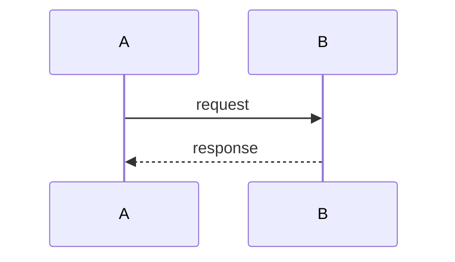

# Quick Presentation

Turn a concept or source material into a standardized slide deck. Default output is a single Marp Markdown file; the "rich" mode produces a Slidev project when the deck needs native diagrams or interactive components.

This skill is the implementation of DOC-132 and follows the research recommendation in `research/DOC-132/presentation-framework-selection.md` of the relevant workspace.

## Instructions

Follow these steps in order.

### Step 1: Gather material and intent

Ask the user via `AskQuestion` (batch the questions):

- **Topic** — one-sentence subject of the deck.
- **Audience** — engineers / managers / mixed / external.
- **Length** — `short` (~8-12 slides), `standard` (~15-25), `deep` (~30+).
- **Source material** — file paths, URLs, Confluence page, or "generate from scratch".
- **Mode** — `default` (Marp) unless the user explicitly needs native Mermaid/PlantUML or interactive Vue components, in which case `rich` (Slidev).

If source material is referenced, read it before drafting. If anything is unclear or contradicts itself, ask a focused follow-up before generating.

### Step 2: Choose mode

Default to **Marp**. Switch to **Slidev** only if any of these are true:

- Deck contains more than 2 diagrams that must stay editable (text-source Mermaid/PlantUML in the final file).
- Deck needs interactive charts or embedded Vue components.
- User explicitly asks for Slidev, `--rich`, or "live code" decks.

Confirm the chosen mode back to the user in one line.

### Step 3: Determine paths

- Topic slug: kebab-case, 3-6 words, no dates (e.g. `rag-architecture-overview`).
- Output root: `docs/presentations/{topic-slug}/`
- Marp deck path: `docs/presentations/{topic-slug}/slides.md`
- Slidev project path: `docs/presentations/{topic-slug}/` (scaffolded Node project)
- Diagram asset dir (Marp only): `docs/presentations/{topic-slug}/assets/diagrams/`

Create directories that do not exist. Do not overwrite an existing deck without asking.

### Step 4: Initialise the deck directory

**Marp mode:**

1. Copy `~/.cursor/skills/quick-presentation/theme.css` to `docs/presentations/{topic-slug}/theme.css`.
2. Create `docs/presentations/{topic-slug}/assets/diagrams/`.
3. Create `slides.md` from the Marp skeleton below.
4. Create `docs/presentations/{topic-slug}/.marprc.yml` for Marp CLI (see **Marp theme registration** below).
5. Register the deck theme in the user's **Cursor/VS Code user settings** (not workspace `.vscode/settings.json`) — see **Marp theme registration** below.

**Slidev mode:**

1. Run `npm init slidev@latest -- --force --template default docs/presentations/{topic-slug}` in the workspace root. If `npm`/`node` is missing, stop and report the blocker; do not silently fall back to Marp.
2. Replace the scaffold's `slides.md` with the Slidev skeleton below.

### Step 5: Draft the deck

Use the standard slide skeleton (adapt to length):

1. Title slide — topic, subtitle, author, date.
2. Agenda — 3-6 bullets matching top-level sections.
3. Context / motivation — why this deck exists; one-paragraph problem framing.
4. Core content — one section per agenda bullet; use code / diagram / chart / two-column slides from `EXAMPLE.md` where they fit.
5. Summary — 3-5 takeaways.
6. Q&A / Next steps.

Rules while drafting:

- Single idea per slide. Aim for ≤ 7 lines of body text per slide.
- Code blocks always specify a language tag. Keep them under 20 lines; split long snippets across slides.
- One diagram per slide, captioned.
- No emojis in the deck unless the user asks for them.
- Do not invent facts. If source material is silent on a point, flag it as a speaker-note TODO.

#### Marp frontmatter skeleton

```markdown
---
marp: true
theme: quick-presentation
paginate: true
title: "{Deck title}"
author: "{Author}"
date: "{YYYY-MM-DD}"
---

<!-- _class: title -->
# {Deck title}
**{Subtitle}**
{Author} — {YYYY-MM-DD}

---

## Agenda
- ...

---
```

Slides are separated by `---` on its own line, preceded by a blank line. Use `<!-- _class: section -->` for section-divider slides and `<!-- _class: title -->` for the cover. Avoid the `lead` and `invert` Marp classes in decks intended for PDF/PPTX export — they have open export bugs as of 2026-04-21.

#### Slidev frontmatter skeleton

```markdown
---
theme: default
title: "{Deck title}"
info: "{One-line description}"
author: "{Author}"
date: "{YYYY-MM-DD}"
transition: slide-left
mdc: true
---

# {Deck title}
{Subtitle}

---
layout: two-cols
---

# Agenda
- ...

::right::

(optional visual)
```

### Step 6: Handle diagrams

**Marp mode** — Mermaid is not native, so pre-render:

1. Write each diagram's source to `assets/diagrams/{n}-{slug}.mmd`.
2. Run the bundled helper:
   ```bash
   bash ~/.cursor/skills/quick-presentation/scripts/render_mermaid.sh \
       docs/presentations/{topic-slug}/assets/diagrams/{n}-{slug}.mmd
   ```
   This produces `{n}-{slug}.svg` next to the `.mmd` file.
3. Embed in the slide with ``.

Keep the `.mmd` source alongside the `.svg` so future edits stay diff-friendly.

**Slidev mode** — use Mermaid code blocks directly:

````markdown

````

### Step 7: Charts

**Marp mode** — render charts outside the deck and embed as images (PNG or SVG) under `assets/charts/`. Do not attempt inline chart libraries.

**Slidev mode** — use a Vue component that wraps a chart library, or embed an image. Prefer images unless the user explicitly asks for interactive charts.

### Step 8: Preview and export

Instruct the user with these one-liners (print them in the final summary):

**Marp preview in VS Code / Cursor:** install the "Marp for VS Code" extension, open `slides.md`, click the Marp preview icon.

#### Marp theme registration (VS Code / Cursor)

The shipped `quick-presentation` theme must be registered before the Marp for VS Code extension recognizes `theme: quick-presentation` in frontmatter. Without registration, preview silently falls back to Marp's built-in `default` theme.

**Where to configure:** user profile settings, not per-repo workspace settings. On macOS:

`~/Library/Application Support/Cursor/User/settings.json` (or the VS Code equivalent).

**What to add** (append one line per new deck):

```jsonc
// Marp: paths are workspace-relative; globs are not supported (marp-team/marp-vscode#454).
// Add a line when you scaffold docs/presentations/{topic-slug}/theme.css.
"markdown.marp.themes": [
    "docs/presentations/{topic-slug}/theme.css"
],
"markdown.marp.enableHtml": true
```

Rules:

- **No glob / auto-discovery.** Marp for VS Code does not scan `docs/presentations/` — each `theme.css` must be listed explicitly ([marp-vscode#454](https://github.com/marp-team/marp-vscode/issues/454)).
- **Paths are workspace-relative.** The same user-settings entry works in any repo that uses `docs/presentations/{topic-slug}/theme.css`.
- **Do not add `.vscode/settings.json` for Marp themes** unless the user explicitly wants repo-local overrides; prefer user settings so decks work across workspaces.
- **When scaffolding a new deck**, append `docs/presentations/{topic-slug}/theme.css` to the user's `markdown.marp.themes` array and remind them to reload the window if preview does not pick it up.
- **Marp CLI is separate.** Per-deck `.marprc.yml` handles CLI export:

```yaml
themeSet:
  - ./theme.css
allowLocalFiles: true
options:
  html: true
```

Optional consolidation: if the user wants zero per-deck maintenance, standardize on one shared `docs/presentations/theme.css` per repo and keep a single entry in user settings. The skill's default layout (one `theme.css` per deck) is fine for deck-specific overrides.

**Marp CLI export:**

```bash
npx @marp-team/marp-cli@latest docs/presentations/{topic-slug}/slides.md -o slides.html
npx @marp-team/marp-cli@latest docs/presentations/{topic-slug}/slides.md --pdf
npx @marp-team/marp-cli@latest docs/presentations/{topic-slug}/slides.md --pptx
```

**Slidev preview + export:**

```bash
cd docs/presentations/{topic-slug}
npm install
npm run dev       # http://localhost:3030
npm run build     # static HTML
npm run export    # PDF
```

### Step 9: Summary to the user

Print:

- Mode chosen and why.
- Deck path.
- Preview command.
- Whether the new `theme.css` path was added to user `markdown.marp.themes` (Marp mode only).
- Export commands for HTML / PDF / PPTX.
- Open TODOs left in speaker notes (if any).

## Reusable slide elements

For concrete Marp slide snippets (title, agenda, code, diagram, chart, two-column, callout, summary), see [EXAMPLE.md](EXAMPLE.md). Copy snippets into the draft when they fit rather than reinventing them.

## Bundled assets

- [EXAMPLE.md](EXAMPLE.md) — reference Marp deck demonstrating every standard slide type.
- `theme.css` — shipped Marp theme named `quick-presentation`. Copied into the output dir by Step 4.
- `scripts/render_mermaid.sh` — Mermaid-CLI wrapper; converts `.mmd` files to `.svg`. Requires `npx` (Node.js).

## Authoring rules to enforce during the run

- Write clean YAML frontmatter in one pass; do not rely on a post-save formatter. Workspace markdown formatters can break YAML — see the note in `research/DOC-132/presentation-framework-selection.md` of the corresponding research workspace.
- Never commit placeholder text like "Lorem ipsum" or `TODO`. If content is missing, leave an explicit speaker note `<!-- SPEAKER NOTE: need data for X -->` and list it in the summary.
- Pin versions when scripting: `@marp-team/marp-cli@4.x` and `@mermaid-js/mermaid-cli@11.x` are the known-good majors as of 2026-04-21.
- Respect the mode: do not sneak Slidev syntax into a Marp deck or vice versa.
- Ask at most 1-2 clarifying questions at a time.
- After scaffolding a Marp deck, register `docs/presentations/{topic-slug}/theme.css` in the user's Cursor/VS Code settings (`markdown.marp.themes`); do not rely on workspace `.vscode/settings.json` unless asked.
