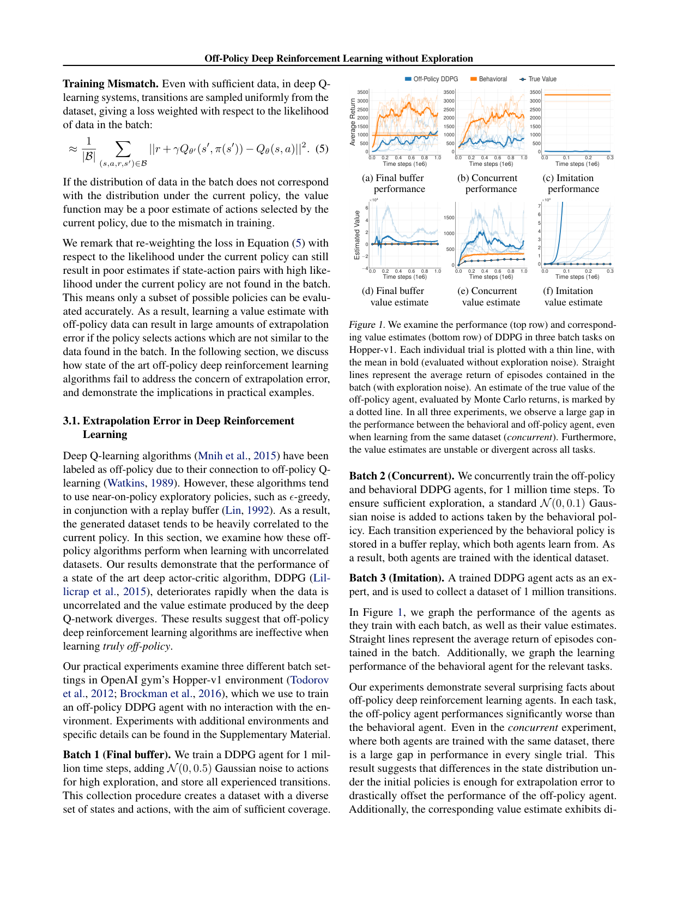
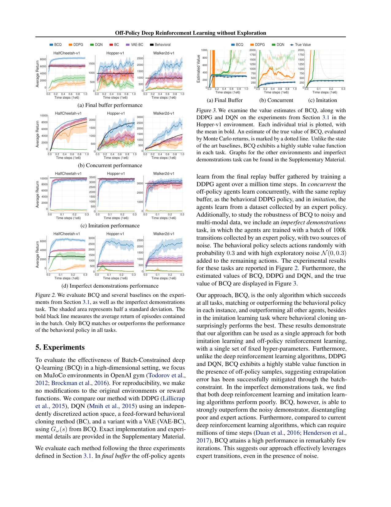

# Off-Policy Deep Reinforcement Learning without Exploration

**[PAPER REVIEW - ICML 2019]{.badge .badge-theory}** **[Offline Reinforcement Learning]{.badge .badge-practice}**

!!! abstract "Executive Summary & Core Delta"
    - **Authors / Venue:** Scott Fujimoto, David Meger, Doina Precup (ICML 2019)
    - **The Bottleneck:** Standard off-policy continuous deep RL algorithms (e.g., DDPG) fail catastrophically when trained on fixed, offline replay buffers without exploration. Out-of-distribution (OOD) action queries in the Bellman target cause function approximators to output wildly overoptimistic values, leading to compounding **extrapolation error** where Q-estimates explode into the millions while true returns collapse to zero.
    - **The Recommended Solution:** Formulates the *batch-constrained reinforcement learning* paradigm and proposes **Batch-Constrained deep Q-learning (BCQ)**. BCQ restricts action selection to state-action pairs supported by the batch by combining a state-conditioned Variational Autoencoder (CVAE) action sampler, a bounded local perturbation network ($\pm \Phi$), and a soft Clipped Double Q-ensemble ($\lambda = 0.75$).
    - **The Enduring Lecture (Stealable Idea):** In offline dynamic programming, never let the policy optimize freely over the action space. Action selection must be strictly constrained to the support of the behavioral data distribution, decoupling distribution modeling (support constraint) from value optimization (policy improvement).

---

## 1. Context, Real-World Scenarios & Problem Motivation

### 1.1 Real-World Application Scenarios

!!! info "From Toy Intuition to Industrial Deployment"
    - **Simple Intuitive Scenario:** Consider training an automated robotic arm to assemble fragile electronics using a pre-recorded dataset of 5,000 human operator demonstrations. If a standard off-policy algorithm is allowed to query arbitrary joint torques outside the demonstrated trajectories, minor neural network estimation noise will make an unobserved 200 Nm torque spike appear to yield infinite reward. The arm executes the hallucinated action and smashes the workpiece. Under BCQ, the VAE limits candidate torques strictly to actions demonstrated by human operators, perturbing them only by $\pm 5\%$ to safely optimize speed.
    - **Complex Real-World Application:** Autonomous Driving Fleet Optimization (e.g., Waymo, Cruise, or Tesla FSD data log pipelines). Fleets collect petabytes of driving logs (disengagements, lane changes, urban navigation). Real-world online exploration is legally, ethically, and financially prohibitive—exploring arbitrary steering angles at 100 km/h risks fatal crashes. BCQ's batch-constrained framework enables safe offline policy extraction from static fleet telemetry, guaranteeing that the learned controller never hallucinates steering or braking inputs outside the multi-modal behavior distribution of experienced human drivers ([Dulac-Arnold et al., 2021](https://arxiv.org/abs/1904.12901)).

### 1.2 Direct Problem Evidence & Formalization Overview

In conventional reinforcement learning, the off-policy guarantee asserts that algorithms like Q-learning can learn the optimal policy using transitions collected by an arbitrary behavioral policy $\pi_b$. Fujimoto et al. demonstrate that in deep continuous RL, this assumption fails catastrophically in the absence of active exploration.

The core failure mode is **Extrapolation Error**: a mismatch between the dataset's state-action visitation distribution and the distribution queried by the target policy's Bellman update:

$$\mathcal{T} Q(s, a) = r(s, a) + \gamma \mathbb{E}_{s' \sim p} \left[ \max_{a'} Q(s', a') \right]$$

When calculating $\max_{a'} Q(s', a')$, if the maximizer $a'$ falls into an unobserved region where the replay buffer $\mathcal{B}$ has zero support, the neural critic has no data to regularize its output. Because of maximization bias and random initialization variance, the critic outputs arbitrarily high values. The $\max$ operator latches onto these positive outliers, propagating hallucinated values backward through the Bellman equations until value estimates diverge to infinity.


*Figure 1 from Fujimoto et al. (2019): DDPG value estimates explode into millions on HalfCheetah-v1 (top right) while true evaluation return collapses to zero (top left).*

---

## 2. Theoretical Background, Taxonomy & Prerequisites

### 2.1 Prerequisite Knowledge Map

| Domain | Required Concepts | Why It Is Needed in This Paper |
| :--- | :--- | :--- |
| **Mathematics** | Measure theory, Support of distributions, Convex combinations | Formalizing the batch-constrained condition $\pi(a\|s) > 0 \implies (s, a) \in \text{supp}(\mathcal{B})$ and tuning the pessimism parameter $\lambda$. |
| **Machine Learning / AI** | Conditional Variational Autoencoders (CVAE), ELBO, Reparameterization trick | Modeling the multi-modal behavioral action distribution $P_\mathcal{B}(a\|s)$ and sampling batch-consistent actions at inference. |
| **Computer Science / Systems** | Clipped Double Q-learning, Deterministic Policy Gradient (DPG), Experience Replay buffers | Building stable continuous actor-critic targets and managing offline replay transitions without environment interaction. |

### 2.2 Formal Taxonomy & Notation Table

| Symbol / Term | Domain / Shape | Definition & Role in Paper |
| :--- | :--- | :--- |
| $\mathcal{B}$ | Set of transitions $(s, a, r, s')$ | The fixed, static replay buffer containing historical environment interactions without active exploration. |
| $\pi_b(a \| s)$ | Probability distribution | The behavioral policy (or mixture of policies) that originally collected the batch $\mathcal{B}$. |
| $\epsilon_{\text{extrap}}(s, a)$ | $\mathbb{R}$ | Extrapolation error: difference between true $Q(s, a)$ and function approximation $Q_\theta(s, a)$ induced by unobserved queries. |
| $G_\omega = (E_{\omega_1}, D_{\omega_2})$ | Neural Networks | Conditional Variational Autoencoder; encoder $E_{\omega_1}(s, a)$ and decoder $D_{\omega_2}(s, z)$ modeling $P_\mathcal{B}(a \| s)$. |
| $z$ | $\mathbb{R}^d \sim \mathcal{N}(0, I)$ | Latent Gaussian representation of continuous actions in the CVAE. |
| $\xi_\phi(s, a, \Phi)$ | $\mathbb{R}^{\dim(A)} \in [-\Phi, \Phi]$ | Perturbation network; outputs a residual action adjustment bounded by hyperparameter $\Phi$. |
| $\Phi$ | $\mathbb{R}^+$ (Scalar) | Maximum action perturbation threshold (trust-region radius, typically $0.05$). |
| $Q_{\theta_1}, Q_{\theta_2}$ | $\mathcal{S} \times \mathcal{A} \to \mathbb{R}$ | Twin Q-critics trained to evaluate state-action pairs and combat maximization bias. |
| $\lambda$ | $[0, 1]$ (Scalar) | Pessimism weighting parameter in the soft Clipped Double Q target (set to $0.75$). |
| $N$ | Integer | Number of candidate actions sampled from the CVAE generator for each state (typically $N=10$). |

---

## 3. Related Works & Competitive Landscape

| Competing Method | Core Approach | Key Limitation / Failure Mode | How This Paper Differs |
| :--- | :--- | :--- | :--- |
| **Fitted Q-Iteration (FQI) / LSPI** ([Ernst et al., 2005](https://dl.acm.org/doi/10.5555/1248547.1248555)) | Dynamic programming with linear / tree / kernel approximations on static batches. | Fails completely in high-dimensional continuous control; lacks scalable deep neural network parameterization. | Formulates batch learning for modern deep neural networks with continuous state-action spaces. |
| **Deep Q-learning from Demonstrations (DQfD)** ([Hester et al., 2018](https://arxiv.org/abs/1704.03732)) | Seeds the replay buffer with expert demonstrations and adds a margin loss to Q-learning. | Strictly requires **online active exploration** after initialization; diverges if restricted to the offline batch. | Operates in the strictly **offline (batch-only)** regime with zero environment interactions. |
| **Behavioral Cloning (BC)** ([Pomerleau, 1989](https://proceedings.neurips.cc/paper/1988/file/812b4ba287f5ee0bc9d43bbf5bbe87fb-Paper.pdf)) | Supervised learning maximizing likelihood $\mathbb{E}_{(s, a) \sim \mathcal{B}}[\log \pi(a \| s)]$. | Cannot perform trajectory stitching; performance is strictly bounded by the average quality of the logging policy. | Uses Q-values to perform policy improvement and trajectory stitching, outperforming the behavioral policy. |
| **DDPG / TD3 Offline** ([Lillicrap et al., 2015](https://arxiv.org/abs/1509.02971); [Fujimoto et al., 2018](https://arxiv.org/abs/1802.09477)) | Standard unconstrained continuous actor-critic trained directly on the static replay buffer. | Extrapolation error causes catastrophic overestimation ($Q \to 10^7$) and complete policy failure. | Enforces batch constraint through CVAE action generation and bounded perturbation. |

---

## 4. Methodology & Engineering Architecture

### 4.1 Plain-Words Formulation & Data Flow

BCQ divides continuous decision-making into three coordinated stages:
1. **Candidate Action Generation:** Given state $s$, the Conditional VAE samples $N$ action candidates from the latent distribution $z \sim \mathcal{N}(0, I)$, ensuring all candidates remain on the manifold of observed dataset actions.
2. **Local Policy Improvement (Perturbation):** Each candidate action $a_i$ is fed into a perturbation network $\xi_\phi$, which adds a slight deterministic adjustment $\Delta a_i \in [-\Phi, \Phi]$. This enables the agent to discover superior actions within a tight local trust region.
3. **Pessimistic Evaluation & Greedy Selection:** Twin Q-networks evaluate each perturbed candidate. The action maximizing the soft double Q-value is selected for execution.

```mermaid
graph LR
    subgraph Action Generation
        S[State s] --> Enc[CVAE Decoder D_w2]
        Z["Latent z ~ N(0, I)"] --> Enc
        Enc -->|Sample N Actions| Cand["Candidate Actions {a_1, ..., a_N}"]
    end

    subgraph Trust-Region Perturbation
        S --> Pert["Perturbation Net xi_phi"]
        Cand --> Pert
        Pert -->|Add Delta a in [-Phi, Phi]| PertCand["Perturbed Actions {a_i + xi_phi}"]
    end

    subgraph Critic Evaluation & Selection
        PertCand --> Q1["Critic Q_theta1"]
        PertCand --> Q2["Critic Q_theta2"]
        Q1 --> SoftQ["Soft Clipped Double Q: lambda*min + (1-lambda)*max"]
        Q2 --> SoftQ
        SoftQ --> BestA["Selected Action a* = argmax SoftQ"]
    end
```

### 4.2 Official Mathematical Formulation

#### 1. Conditional Variational Autoencoder Loss (ELBO)
To learn the batch action distribution $P_\mathcal{B}(a \| s)$, the encoder $E_{\omega_1}(s, a)$ outputs Gaussian parameters $\mu(s, a), \sigma(s, a)$, and the decoder $D_{\omega_2}(s, z)$ reconstructs the action:

$$
\mathcal{L}_{\text{VAE}}(\omega) = \mathbb{E}_{(s, a) \sim \mathcal{B}} \left[ \| a - D_{\omega_2}(s, z) \|^2 + D_{\text{KL}}\left(\mathcal{N}(\mu, \sigma^2) \,||\, \mathcal{N}(0, I)\right) \right]
$$

where $z = \mu + \sigma \odot \epsilon$ and $\epsilon \sim \mathcal{N}(0, I)$ via the reparameterization trick.

#### 2. Perturbation Network Objective
The perturbation network $\xi_\phi(s, a, \Phi) = \Phi \tanh(\cdot)$ learns a residual offset within $[-\Phi, \Phi]$ by maximizing the first critic's value estimates:

$$
\max_\phi \mathbb{E}_{s \sim \mathcal{B}, \, a_i \sim G_\omega(s)} \left[ Q_{\theta_1}\left(s, a_i + \xi_\phi(s, a_i, \Phi)\right) \right]
$$

#### 3. Target Value with Soft Clipped Double Q-learning
For transition $(s, a, r, s')$, the target value $y$ evaluates the $N$ sampled next-actions $\{a_i\}_{i=1}^N \sim G_{\omega'}(s')$ perturbed by $\xi_{\phi'}$:

$$
y = r + \gamma \max_{a_i} \left[ \lambda \min_{j=1,2} Q_{\theta'_j}(s', a_i + \xi_{\phi'}(s', a_i, \Phi)) + (1-\lambda) \max_{j=1,2} Q_{\theta'_j}(s', a_i + \xi_{\phi'}(s', a_i, \Phi)) \right]
$$

Critics minimize the mean squared Bellman error against target $y$:

$$
\mathcal{L}(\theta_1, \theta_2) = \mathbb{E}_{(s, a, r, s') \sim \mathcal{B}} \left[ \left( Q_{\theta_1}(s, a) - y \right)^2 + \left( Q_{\theta_2}(s, a) - y \right)^2 \right]
$$

#### 4. Test-Time Execution Policy
At test time, the agent greedily selects the highest-value candidate among $N$ samples:

$$
\pi(s) = \arg\max_{a_i + \xi_\phi(s, a_i, \Phi)} Q_{\theta_1}\left(s, a_i + \xi_\phi(s, a_i, \Phi)\right), \quad \text{where } \{a_i\}_{i=1}^N \sim G_\omega(s)
$$

### 4.3 Engineering Solutions & Design Justifications

- **Conditional VAE ($G_\omega$):** Real behavioral data is multimodal (e.g., navigating left vs. right around an obstacle). A standard deterministic regression network averages conflicting actions, producing fatal midpoint collisions. The CVAE models arbitrary multimodal distributions faithfully and generates realistic action seeds.
- **Perturbation Model ($\xi_\phi$):** Pure generative sampling only reproduces demonstrated actions. The perturbation model introduces a local gradient-based trust region $[-\Phi, \Phi]$, allowing the policy to improve upon sub-optimal demonstration actions without drifting outside the critic's reliable estimation domain.
- **Soft Clipped Double Q ($\lambda = 0.75$):** Standard TD3 uses a hard minimum ($\lambda = 1.0$), which can be excessively conservative in sparse offline datasets. Setting $\lambda = 0.75$ imposes strong protection against overestimation while retaining a $25\%$ optimistic weighting to maintain learning momentum.

### 4.4 Methodological Pitfalls & Brittle Assumptions

!!! warning "Upfront Methodological Critique"
    - **User-Identified Pitfalls:**
      - **High Hyperparameter Sensitivity:** The perturbation bound $\Phi$, candidate count $N$, and pessimism weight $\lambda$ interact delicately. Setting $\Phi$ too small prevents improvement over the behavior policy; setting $\Phi$ too large triggers immediate extrapolation catastrophe.
      - **Compute Overhead & Pipeline Latency:** Managing four separate networks ($E_{\omega_1}, D_{\omega_2}, \xi_\phi, Q_{\theta_1}, Q_{\theta_2}$) with chained forward passes creates noticeable training and inference bottlenecks.
      - **Uniform Replay Sampling:** Sampling transitions uniformly at random ignores critical trajectory segments, bottleneck states, and rare successful recoveries.
    - **Antigravity Technical Audit:**
      - **Isotropic Euclidean Trust Region Assumption:** The perturbation model bounds actions within a uniform hypercube $[-\Phi, \Phi]^{\dim(A)}$ via $\tanh$. In physical robotics (e.g., multi-link manipulators), physical validity manifolds are non-Euclidean; a fixed scalar $\Phi$ can easily trigger self-collisions or joint velocity violations.
      - **Inference-Time Sampling Variance:** Because action selection relies on sampling $N=10$ random latents at every environment step, the policy is stochastic during inference, which can lead to jittery control in high-frequency closed-loop execution.

---

## 5. Experiments, Evaluation & Results Interrogation

### 5.1 Experimental Setup & Benchmark Audit

- **Pre-Read Prediction vs. Actual Setup:** The authors evaluated BCQ on standard continuous control tasks against behavioral and offline baselines across three distinct data regimes:
  1. **Final Buffer:** 1M transitions from a full DDPG training run (spanning early random, exploratory, and late expert policies).
  2. **Concurrent:** BCQ trained simultaneously on the growing replay buffer of an active online exploratory DDPG agent.
  3. **Imitation:** 1M transitions generated by a fixed expert policy with varying Gaussian noise ($\sigma \in \{0.1, 0.3\}$).
- **Official Benchmarks & Metrics:** Evaluated on OpenAI Gym / MuJoCo tasks (`HalfCheetah-v1`, `Hopper-v1`, `Walker2d-v1`, `Ant-v1`). Performance measured by average true environment return over 10 evaluation episodes across 5 random seeds, alongside value estimation error ($Q(s, a) - \text{Return}$).
- **Reproducibility & Rigor:** The experimental design includes standard deviations across 5 seeds. However, the evaluation was restricted to 4 standard locomotion benchmarks, omitting manipulation, sparse-reward, or visual-motor domains.

### 5.2 Quantitative Results & Ablation Breakdown


*Figure 2 & 3 from Fujimoto et al. (2019): Benchmark performance curves across environments (left) and value estimation tracking vs. true returns (right).*

- **Trajectory Stitching Outperforms Behavioral Policies:** In the *Final Buffer* and *Concurrent* regimes, BCQ achieved higher returns than the behavioral agent that generated the data. Because the buffer contained exploratory transitions with varying success, BCQ's Q-critics successfully stitched together the highest-value sub-trajectories.
- **Ablation MVP (Perturbation Bound $\Phi$):** The authors demonstrated that $\Phi = 0.05$ delivers the optimal trade-off:
  - When $\Phi = 0$, BCQ acts as an argmax-filtered Behavior Cloner, achieving decent returns but failing to improve upon suboptimal behaviors.
  - When $\Phi > 0.15$, performance collapses due to out-of-distribution extrapolation error.
- **Sample Count $N$:** Setting $N=10$ provided sufficient candidate diversity. Increasing $N \to 100$ yielded diminishing returns at substantial computational cost, while $N=1$ degraded to greedy imitation.

!!! tip "Visualization & Reporting Audit"
    - **What the Authors Highlighted:** The stark contrast between DDPG's explosive overestimation ($10^7$) and BCQ's bounded, well-calibrated value estimates (Figure 1 and Figure 3).
    - **What Was Downplayed / Ignored:** BCQ's performance gains over pure VAE-BC on the *Imitation* dataset were modest when the demonstration policy had low noise ($\sigma = 0.1$), indicating that when the data distribution is narrow, dynamic programming adds limited value over supervised cloning.
    - **Visualization Critique:** Value estimation tracking (Figure 3) was showcased primarily on Hopper-v1; reporting value calibration curves systematically across all environments and noise levels would have provided a clearer picture of value stability.

---

## 6. Conclusions, Limitations & Future Trajectory

### 6.1 Clear Wins & Practical Application Lecture

- **The Genesis of Offline RL:** BCQ established that extrapolation error—not sample complexity—is the primary obstacle preventing off-policy deep RL from learning on fixed datasets.
- **Transferable Architectural Design:** Decoupling density estimation (CVAE) from value-driven policy improvement (perturbation + Q-ranking) became a foundational design pattern across robotics and offline decision systems.
- **Trajectory Stitching in Practice:** Proved that offline RL can extract an expert-level policy from a dataset containing predominantly sub-optimal, noisy, or exploratory behaviors.

### 6.2 Unmentioned Limitations & Future Work Verdict

- **Authors' Stated Future Work:** Extending batch-constrained reinforcement learning to discrete action spaces and combining offline pre-training with safe online exploratory fine-tuning.
- **Critical Verdict (Worth Pursuing?):**
  - The offline-to-online fine-tuning direction proved to be immensely valuable and remains a frontier in robotics foundation models.
  - However, the explicit CVAE + perturbation architecture proved overly complex. Subsequent literature successfully eliminated the generative model entirely:
    - **Value Penalization (CQL):** Directly regularizes out-of-distribution Q-values without needing an explicit generative model ([Kumar et al., 2020](https://arxiv.org/abs/2006.04779)).
    - **Implicit Policy Extraction (IQL):** Avoids evaluating OOD actions entirely via expectile regression ([Kostrikov et al., 2021](https://arxiv.org/abs/2110.06169)).
    - **Simple Policy Regularization (TD3+BC):** Matches or exceeds BCQ using a simple behavioral cloning penalty added to TD3's actor loss ([Fujimoto & Gu, 2021](https://arxiv.org/abs/2106.06860)).

---

## 7. Follow-Up Action Items (From the Parking Lot)

<details markdown="1">
<summary>Prerequisite Concepts & Priority Citations to Triage Next</summary>

- **Concepts Clarified:**
  1. **CVAE ELBO & KL Divergence Regularization:** The Evidence Lower Bound (ELBO) balances reconstruction accuracy (decoding actions from latent $z$) against latent regularization (KL divergence to $\mathcal{N}(0, I)$). In BCQ, the KL penalty ensures that sampling $z \sim \mathcal{N}(0, I)$ at test time yields valid, in-distribution actions without requiring ground-truth action inputs.
  2. **Soft Clipped Double Q ($\lambda$ Convex Combination):** Blends the conservative minimum $\min(Q_1, Q_2)$ (pessimism against overestimation) with $\max(Q_1, Q_2)$ via $\lambda \min + (1-\lambda) \max$. With $\lambda = 0.75$, it prevents divergence without succumbing to the chronic underestimation that hampers policy improvement in sparse offline datasets.
- **Next Papers for a 10-Minute Triage Pass:**
  1. **MuJoCo (Todorov et al., 2012):** Physics engine and standard benchmark suite used across continuous control RL.
  2. **DDPG (Lillicrap et al., 2015):** Foundational continuous actor-critic algorithm whose failure under static buffers catalyzed the entire field of offline RL.

</details>

