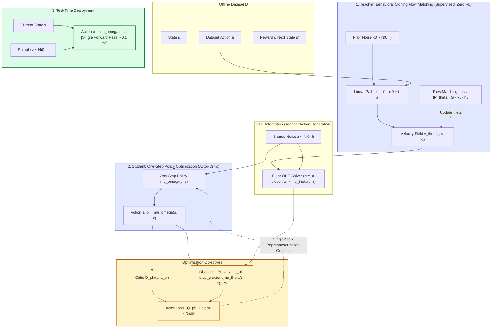

# Flow Q-Learning

**[PAPER REVIEW - ARXIV 2025]{.badge .badge-theory}** **[Offline Reinforcement Learning]{.badge .badge-practice}**

!!! abstract "Executive Summary & Core Delta"
    - **Authors / Venue:** Seohong Park (UC Berkeley), Qiyang Li (UC Berkeley), Sergey Levine (UC Berkeley) — **arXiv 2025** ([arXiv:2502.02538](https://arxiv.org/abs/2502.02538)).
    - **The Bottleneck:** While iterative generative policies (diffusion models, continuous normalizing flows) excel at modeling complex, multimodal action distributions, steering them to maximize a learned Q-function in offline RL is notoriously challenging. Existing policy extraction methods suffer from severe trade-offs: **Backpropagation Through Time (BPTT)** through numerical ODE/SDE solvers causes gradient instability and high GPU memory consumption; **Advantage-Weighted Regression (AWR/AWAC)** suffers from low effective sample size and mode collapse; and test-time **Rejection Sampling (IDQL)** demands querying the generative model $N$ times per step, causing prohibitive inference latency for real-time control.
    - **The Recommended Solution:** **Flow Q-Learning (FQL)** decouples generative distribution modeling from value maximization through **One-Step Guidance**. A continuous-time BC Flow Policy $\mu_\theta(s, z)$ is trained solely via supervised flow matching on dataset actions (receiving zero RL gradients). Concurrently, a separate feedforward **One-Step Policy** $\mu_\omega(s, z)$ is trained via standard actor-critic to maximize Q-values while distilling from the multi-step flow teacher via an action-space Euclidean penalty. This distillation objective bounds the squared 2-Wasserstein distance $\mathcal{W}_2^2(\pi_\omega, \pi_\theta)$, providing a metric-aware behavioral constraint while eliminating BPTT and reducing test-time inference to a single forward pass.
    - **The Enduring Lecture (Stealable Idea):** Decouple expressive generative behavior priors from reinforcement learning policy optimization. Train the generative teacher with pure supervised imitation to capture multimodality, and distill it into a single-step student guided by single-step reparameterized Q-gradients. This delivers diffusion-level expressivity at Gaussian-level inference speeds ($\approx 0.1\text{ ms}$).

---

## 1. Context, Real-World Scenarios & Problem Motivation

### 1.1 Real-World Application Scenarios

!!! info "From Toy Intuition to Industrial Deployment"
    - **Simple Intuitive Scenario:** Consider a 2D robotic arm reaching for an object positioned behind a central pillar. Historical human demonstrations contain bimodal trajectories: 50% maneuver around the pillar from the left, and 50% maneuver from the right. A standard unimodal Gaussian policy (e.g. TD3+BC) averages both modes, issuing actions that command the arm straight forward into the pillar. An iterative diffusion policy captures both distinct paths, but steering it via reinforcement learning to favor the shorter path requires backpropagating through 10–50 denoising solver steps, causing exploding gradients. Flow Q-Learning trains a multi-step flow model purely on demonstrations to capture both paths, and then trains a single-step student policy $\mu_\omega(s, z)$ that uses the critic's gradient field to choose the higher-reward mode in a single forward evaluation without colliding or stalling.
    - **Complex Real-World Application:** High-Frequency Robotic Manipulation & Autonomous Fleet Fine-Tuning (e.g., [ALOHA multi-task manipulation](https://tonyzhaozh.github.io/aloha/); [Open X-Embodiment Collaboration, 2024](https://arxiv.org/abs/2310.08864); [Physical Intelligence $\pi_0$](https://www.pi.website/download/rlt.pdf)). In real-world assembly or dexterous hand manipulation, robot controllers operate at 20–50 Hz (20–50 ms control loops). Multi-step diffusion policies require 10–50 denoising iterations per step, introducing 100–500 ms of latency that destabilizes contact-rich tasks. Furthermore, fine-tuning diffusion policies online with trial-and-error frequently causes policy collapse. FQL enables deploying a single-step feedforward MLP running in $<1\text{ ms}$ on edge hardware that inherits the multimodal behavioral support of continuous normalizing flows and seamlessly adapts online without an offline-to-online performance plunge.

### 1.2 Direct Problem Evidence & Formalization Overview

In offline reinforcement learning, an agent must extract a high-performing policy $\pi(a \mid s)$ from a static dataset $\mathcal{D} = \{(s, a, r, s')\}$ without environment interactions. The foundational challenge is **out-of-distribution (OOD) action extrapolation**: querying values for actions outside the dataset distribution causes standard Bellman backups to overestimate returns.

To constrain policy actions within the data support, behavior-regularized actor-critic optimizes:
$$
\max_{\pi} \mathbb{E}_{s \sim \mathcal{D}, a \sim \pi(\cdot \mid s)} \left[ Q(s, a) \right] - \alpha \cdot \mathcal{D}_{\text{reg}}(\pi(\cdot \mid s), \pi^\beta(\cdot \mid s))
$$
When datasets are large and diverse (e.g., multi-operator teleoperation logs), $\pi^\beta$ is highly multimodal. While continuous normalizing flows and diffusion models can represent arbitrary continuous distributions, extracting an optimal policy from a learned critic $Q_\phi(s, a)$ has historically required picking among three flawed paradigms:

1. **Advantage-Weighted Regression (AWR / AWAC):** Reweights dataset actions by $\exp(\frac{Q(s,a) - V(s)}{\beta})$. Simple to implement, but suffers from low effective sample size and mode collapse.
2. **Reparameterization with BPTT (Diffusion-QL, Consistency-AC):** Propagates $\nabla_\theta Q(s, a)$ through all intermediate steps of an SDE/ODE solver. Highly unstable, prone to vanishing/exploding gradients, and memory-intensive.
3. **Rejection Sampling (IDQL):** Samples $N$ candidate actions from a frozen generative model at test time and selects $\arg\max_{i=1\dots N} Q(s, a_i)$. Requires $N$ sequential or parallel generative rollouts per step, creating severe latency bottlenecks.

FQL resolves this trilemma by replacing iterative policy gradients with **one-step distillation**, training an unrolled student policy directly against an ODE teacher.

---

## 2. Theoretical Background, Taxonomy & Prerequisites

### 2.1 Prerequisite Knowledge Map

| Domain | Required Concepts | Why It Is Needed in This Paper |
| :--- | :--- | :--- |
| **Mathematics** | Ordinary Differential Equations (ODEs), Optimal Transport, 2-Wasserstein Metric | Underpins continuous normalizing flows (CNFs) via deterministic vector fields and proves that distillation loss bounds the action-space $\mathcal{W}_2^2$ distance. |
| **Machine Learning / AI** | Flow Matching, Reparameterization Trick, Policy Extraction | Explains straight-line probability paths between noise and data distributions, and how single-step policy gradients optimize expected Q-values. |
| **Computer Science / Systems** | Numerical ODE Solvers (Euler method), Backpropagation Through Time (BPTT), Inference Latency | Explains the computational and numerical failure modes of differentiating through iterative solvers versus single-step feedforward evaluation. |

### 2.2 Formal Taxonomy & Notation Table

| Symbol / Term | Domain / Shape | Definition & Role in Paper |
| :--- | :--- | :--- |
| $\mathcal{S}$ | Metric space | State space of the Markov Decision Process (MDP). |
| $\mathcal{A}$ | $\mathbb{R}^d$ | $d$-dimensional continuous Euclidean action space. |
| $v_\theta(t, s, x)$ | $[0, 1] \times \mathcal{S} \times \mathbb{R}^d \rightarrow \mathbb{R}^d$ | Neural velocity vector field parameterized by $\theta$, conditioned on time $t$, state $s$, and interpolated action $x$. |
| $\psi_\theta(t, s, x)$ | $[0, 1] \times \mathcal{S} \times \mathbb{R}^d \rightarrow \mathbb{R}^d$ | Flow trajectory governed by ODE $\frac{d}{dt}\psi_\theta(t, s, x) = v_\theta(t, s, \psi_\theta(t, s, x))$. |
| $\mu_\theta(s, z)$ | $\mathcal{S} \times \mathbb{R}^d \rightarrow \mathbb{R}^d$ | Multi-step BC flow policy: endpoint $\psi_\theta(1, s, z)$ obtained by integrating $v_\theta$ from $t=0$ to $t=1$ starting from $x_0 = z$. |
| $\mu_\omega(s, z)$ | $\mathcal{S} \times \mathbb{R}^d \rightarrow \mathbb{R}^d$ | One-step student policy parameterized by $\omega$; directly maps noise $z$ and state $s$ to action $a$ in 1 forward pass. |
| $Q_\phi(s, a)$ | $\mathcal{S} \times \mathcal{A} \rightarrow \mathbb{R}$ | Parameterized state-action value function (critic). |
| $\mathcal{W}_2(\pi_\omega, \pi_\theta)$ | $\mathbb{R}_{\ge 0}$ | 2-Wasserstein distance between push-forward action distributions under Euclidean metric. |
| $\alpha$ | $\mathbb{R}_{> 0}$ | Regularization coefficient balancing Q-value maximization and flow distillation. |
| $M$ | $\mathbb{N}$ (Default: 10) | Number of discrete numerical Euler integration steps used during teacher training. |

---

## 3. Related Works & Competitive Landscape

| Competing Method | Core Approach | Key Limitation / Failure Mode | How FQL Differs |
| :--- | :--- | :--- | :--- |
| **ReBRAC / TD3+BC** ([Tarasov et al., 2023a](https://arxiv.org/abs/2305.09836)) | Gaussian policy + Actor-Critic with MSE/KL regularizer | Unimodal Gaussian distribution cannot capture multimodal action distributions; suffers mode collapse or averaging. | Employs continuous flow matching to model arbitrary multimodal distributions while matching Gaussian inference latency. |
| **Diffusion-QL / FBRAC** ([Wang et al., 2023](https://arxiv.org/abs/2208.06193)) | Iterative diffusion/flow policy trained with Q-learning via BPTT | Backpropagating through 10–50 numerical solver steps causes vanishing/exploding gradients and massive GPU VRAM overhead. | Completely eliminates BPTT by training the flow model purely with supervised BC, steering only a 1-step student. |
| **IDQL / IFQL** ([Hansen-Estruch et al., 2023](https://arxiv.org/abs/2304.10573)) | Implicit Q-learning + Test-time Rejection Sampling ($N=128$) | Querying policy and critic $N$ times per control step causes severe latency bottlenecks ($\approx 2\text{ ms}$ vs. $0.1\text{ ms}$). | Trains a deterministic one-step student mapping noise $z$ to high-value actions, running in a single forward pass. |
| **Consistency-AC (CAC)** ([Ding & Jin, 2024](https://arxiv.org/abs/2405.07818)) | Consistency model distillation with actor-critic | Still relies on multi-step gradient propagation and complex consistency training objectives. | Uses simple linear flow matching with straight trajectories and direct Euclidean distillation. |

---

## 4. Methodology & Engineering Architecture

### 4.1 Plain-Words Formulation & Data Flow

Flow Q-Learning structures offline decision-making into three distinct modules: a **Critic** ($Q_\phi$), an expressive **Teacher Flow Policy** ($\mu_\theta$), and a fast **Student One-Step Policy** ($\mu_\omega$).



### 4.2 Official Mathematical Formulation

#### 1. Teacher Behavioral Cloning (Flow Matching)
Given dataset transitions $s, a \sim \mathcal{D}$ and prior noise $x_0 \sim \mathcal{N}(0, I_d)$, the flow matching objective specifies a linear probability path $x_t = (1-t)x_0 + t x_1$ with constant target velocity $\frac{d}{dt}x_t = x_1 - x_0 = a - x_0$:
$$
\mathcal{L}_{\text{Flow}}(\theta) = \mathbb{E}_{\substack{s, a \sim \mathcal{D}, \\ x_0 \sim \mathcal{N}(0, I_d), \\ t \sim \text{Unif}([0, 1])}} \left[ \left\| v_\theta(t, s, (1-t)x_0 + t a) - (a - x_0) \right\|_2^2 \right]
$$
Solving the ODE $\frac{d}{dt}\psi_\theta(t, s, z) = v_\theta(t, s, \psi_\theta(t, s, z))$ from $t=0$ to $t=1$ yields the deterministic mapping $\mu_\theta(s, z) \triangleq \psi_\theta(1, s, z)$.

#### 2. Critic Training (Bellman Error)
The critic $Q_\phi(s, a)$ is updated using standard double Q-learning, evaluating target returns via the one-step policy $\mu_\omega$:
$$
\mathcal{L}_Q(\phi) = \mathbb{E}_{\substack{(s, a, r, s') \sim \mathcal{D}, \\ z' \sim \mathcal{N}(0, I_d)}} \left[ \left( Q_\phi(s, a) - r - \gamma Q_{\bar{\phi}}(s', \mu_\omega(s', z')) \right)^2 \right]
$$
By default, the target value uses the average of double critics: $Q_{\bar{\phi}} = \frac{1}{2}(Q_{\bar{\phi}_1} + Q_{\bar{\phi}_2})$.

#### 3. One-Step Policy Optimization (Actor Loss)
The one-step student $\mu_\omega(s, z)$ is updated via standard single-step reparameterization gradients:
$$
\mathcal{L}_\pi(\omega) = \mathbb{E}_{\substack{s \sim \mathcal{D}, \\ z \sim \mathcal{N}(0, I_d)}} \left[ - Q_\phi(s, \mu_\omega(s, z)) + \alpha \left\| \mu_\omega(s, z) - \text{stop\_gradient}(\mu_\theta(s, z)) \right\|_2^2 \right]
$$

#### 4. Connection to 2-Wasserstein Regularization
Let $\pi_\omega(s)$ and $\pi_\theta(s)$ be the push-forward distributions of Gaussian noise $\xi \sim \mathcal{N}(0, I_d)$ through $\mu_\omega(s, \cdot)$ and $\mu_\theta(s, \cdot)$. Because coupling noise $z$ is shared, the distillation term forms a variational upper bound on the squared 2-Wasserstein distance:
$$
\mathcal{L}_{\text{Distill}}(\omega) = \mathbb{E}_{s \sim \mathcal{D}, z \sim \mathcal{N}(0, I_d)} \left[ \|\mu_\omega(s, z) - \mu_\theta(s, z)\|_2^2 \right] \ge \mathbb{E}_{s \sim \mathcal{D}} \left[ \mathcal{W}_2(\pi_\omega(s), \pi_\theta(s))^2 \right]
$$
Unlike metric-agnostic divergences (KL divergence in TD3+BC/AWAC or $\chi^2$ divergence in CQL), the 2-Wasserstein penalty incorporates the underlying Euclidean metric of physical action space.

### 4.3 Engineering Solutions & Design Justifications

- **Linear Trajectories ($x_t = (1-t)x_0 + ta$):** Straight paths eliminate curved velocity vectors inherent to diffusion SDE schedules, allowing low-order ODE solvers to integrate with minimal truncation error.
- **Euler Solver with $M=10$ Steps:** Uses first-order Euler integration ($z \leftarrow z + \frac{1}{M}v_\theta(\frac{k}{M}, s, z)$). Ablations show $M \ge 4$ yields stable convergence without requiring adaptive Runge-Kutta steps.
- **Uniform Time Sampling ($t \sim \text{Unif}([0, 1])$):** Outperforms or matches complex time sampling heuristics such as Logit-Normal or Beta distributions (Figure 10d).
- **Network Architecture & Normalization:** Uses 4-layer MLPs with hidden dimensions $[512, 512, 512, 512]$ across all networks, with Layer Normalization on critic networks to stabilize value learning.

### 4.4 Methodological Pitfalls & Brittle Assumptions

!!! warning "Upfront Methodological Critique"
    - **User-Identified Pitfalls:**
      - The policy remains anchored to the behavioral distribution, limiting performance when offline data is dominated by highly suboptimal demonstrations.
      - Optimization depends heavily on tuning the balance between value maximization and behavioral cloning.
    - **Antigravity Technical Audit:**
      - **300x Hyperparameter Sensitivity ($\alpha$):** As shown in Figure 7 and Table 6, the optimal $\alpha$ ranges from $1$ on navigation tasks (`antmaze-large-diverse`) to $300$ on manipulation tasks (`cube-double`, `scene`). Setting $\alpha=1$ on manipulation drops performance to 0; setting $\alpha=300$ on navigation freezes the policy. In pure offline settings where online policy evaluation (OPE) is notoriously noisy, tuning $\alpha$ without environment access is an unsolved operational obstacle.
      - **Distillation Approximation on Discontinuous Boundaries:** A continuous feedforward MLP $\mu_\omega$ cannot represent sharp step-discontinuities. On tasks with narrow action peaks (e.g. `puzzle-4x4`), distillation smoothing causes FQL to score only 17, losing to test-time rejection sampling (IDQL: 29).
      - **Unguided Online Fine-Tuning:** Offline-to-online adaptation simply pools online transitions into the replay buffer without exploration bonuses or priority weighting, risking convergence to local optima in complex environments.

---

## 5. Experiments, Evaluation & Results Interrogation

### 5.1 Experimental Setup & Benchmark Audit

- **Evaluation Protocol:** Evaluated on **73 total tasks**: 50 state-based OGBench tasks (5 locomotion, 5 manipulation suites), 5 visual manipulation tasks ($64 \times 64 \times 3$ pixels), and 18 D4RL tasks (AntMaze, Adroit).
- **Statistical Rigor:** 8 random seeds for state tasks, 4 seeds for pixel tasks. Reports mean $\pm$ standard deviation in tables and 95% bootstrap confidence intervals in learning curves. Evaluates checkpoints at final gradient steps (no cherry-picked peak epochs).
- **Compute Parity:** Baselines (ReBRAC, IDQL, Consistency-AC, IFQL, FBRAC, FAWAC) tuned on identical training budgets and matching MLP network architectures.

### 5.2 Quantitative Results & Ablation Breakdown

#### 1. Policy Extraction Comparison (Figure 5)
Averaged across all 50 state-based OGBench tasks under identical network architectures and tuning budgets:

| Method | Extraction Mechanism | Avg. OGBench Score | Relative to FQL |
| :--- | :--- | :---: | :---: |
| **FAWAC** | Advantage-Weighted Regression | 16 | $-63.6\%$ |
| **FBRAC** | Reparameterization with BPTT | 29 | $-34.1\%$ |
| **IFQL** | Rejection Sampling ($N=128$) | 30 | $-31.8\%$ |
| **FQL (Ours)** | **One-Step Guidance (Distillation)** | **44** | **Baseline** |

*Key finding:* Simply replacing direct BPTT (FBRAC) with one-step distillation (FQL) yields a **$+51.7\%$ performance improvement**, confirming that numerical solver backpropagation actively degrades offline policy extraction.

#### 2. Runtime & Latency Audit (Figure 9)
On `cube-double-singletask`:
- **Training Step Time:** FQL requires $\approx 1.2\text{ ms}$ per gradient update, only slightly slower than Gaussian ReBRAC ($\approx 0.8\text{ ms}$) and significantly faster than BPTT flow models ($\approx 2.4\text{ ms}$).
- **Inference Time per Step:** FQL requires $\mathbf{\approx 0.1\text{ ms}}$ (identical to Gaussian policies), whereas multi-step diffusion/flow models require $\mathbf{1.5 - 2.5\text{ ms}}$ (a **$15\times - 25\times$ speedup**).

#### 3. Offline-to-Online Fine-Tuning (Figure 6)
Fine-tuning begins at 1M offline gradient steps. Unlike prior methods (Cal-QL, RLPD, ReBRAC) that often experience initial policy collapse due to distribution shift, FQL transitions seamlessly and maintains monotonic reward improvement.

```
Offline RL Benchmark Performance Highlights (Table 2):
---------------------------------------------------------------------------------------
Task Category                           ReBRAC (Gaussian)   IDQL (Diffusion)   FQL (Ours)
---------------------------------------------------------------------------------------
OGBench antsoccer-arena-singletask             0 ± 0            12 ± 4          60 ± 2  <-- FQL Clears
OGBench cube-double-singletask                12 ± 1            15 ± 6          29 ± 2  <-- FQL Clears
OGBench scene-singletask                      41 ± 3            46 ± 3          56 ± 2  <-- FQL Clears
D4RL antmaze-large-play                       78                79              84 ± 3  <-- SOTA
---------------------------------------------------------------------------------------
OGBench antmaze-giant-singletask              26 ± 8             0 ± 0           9 ± 6  <-- ReBRAC Wins!
OGBench puzzle-4x4-singletask                 14 ± 1            29 ± 3          17 ± 2  <-- IDQL Wins!
D4RL adroit (12 tasks)                        59                52 ± 1          52 ± 1  <-- ReBRAC Wins!
---------------------------------------------------------------------------------------
```

!!! tip "Visualization & Reporting Audit"
    - **What the Authors Highlighted:** Substantial aggregate gains on multimodal manipulation tasks (OGBench scene, cube-double, antsoccer), near-zero inference latency, and smooth offline-to-online fine-tuning curves without policy collapse.
    - **What Was Downplayed / Ignored:**
      1. Simple Gaussian ReBRAC outperforms FQL by nearly $3\times$ on `antmaze-giant` ($26$ vs. $9$) and beats FQL on `adroit` ($59$ vs. $52$).
      2. Test-time rejection sampling (IDQL) beats FQL on precision tile sliding (`puzzle-4x4`: $29$ vs. $17$), exposing distillation error on sharp multimodal boundaries.
      3. The necessity of tuning $\alpha$ across a $300\times$ grid is relegated to Appendix C.
    - **Visualization Critique:** Plotting aggregate bar charts (Figure 5) obscures environment-specific failure modes. Replacing aggregate bars with performance profiles (rliable interquartile mean and probability of improvement) would clearly expose task classes where Gaussian smoothing or rejection sampling remains superior.

---

## 6. Conclusions, Limitations & Future Trajectory

### 6.1 Clear Wins & Practical Application Lecture

1. **Decoupled Architecture as a Design Rule:** Never backpropagate reinforcement learning objectives through multi-step iterative generative models. Use supervised flow matching to build an expressive prior, and distill it into a feedforward student with reparameterized Q-gradients.
2. **Wasserstein Behavioral Regularization:** Penalizing Euclidean action distance bounds $\mathcal{W}_2^2$, providing a physically grounded, metric-aware regularizer superior to metric-agnostic divergences (KL, $\chi^2$).
3. **Real-Time Edge Deployability:** FQL resolves the inference latency barrier that previously prevented diffusion policies from controlling high-frequency continuous robotic systems.

### 6.2 Unmentioned Limitations & Future Work Verdict

- **Authors' Stated Future Work:** Adapting one-step guidance to diffusion models (converting SDEs to ODEs), adding exploration bonuses for online fine-tuning, and scaling to broader visual manipulation tasks.
- **Critical Verdict (Worth Pursuing?):**
  - *High Value:* Incorporating optimistic or count-based exploration into offline-to-online FQL to address flatlining on large navigation tasks (`humanoidmaze-large`).
  - *Missing Priority:* Extending FQL from single-step Markovian actions to **temporal action chunking** ($H=16$), which is the de-facto standard in modern robotic foundation models (e.g. ACT, Diffusion Policy, $\pi_0$).

---

## 7. Follow-Up Action Items (From the Parking Lot)

<details markdown="1">
<summary>Prerequisite Concepts & Priority Citations to Triage Next</summary>

- **Concepts Clarified:**
  1. **Continuous Normalizing Flows (CNFs) & Flow Matching:** A generative framework where samples are transported from a base distribution $p_0 = \mathcal{N}(0, I)$ to data $p_1$ along deterministic trajectories generated by a velocity vector field $v(t, x)$. Unlike diffusion SDEs, straight-path flow matching uses linear interpolation $x_t = (1-t)x_0 + tx_1$, yielding constant velocities that allow fast numerical integration with low-order ODE solvers.
  2. **2-Wasserstein Distance Coupling ($\mathcal{W}_2$):** An optimal transport metric defined as $\mathcal{W}_2(\mu, \nu) = \left( \inf_{\gamma \in \Pi(\mu, \nu)} \mathbb{E}_{(x, y) \sim \gamma} [\|x - y\|_2^2] \right)^{1/2}$. When two policies share common noise $z$, the expected Euclidean distance between their outputs upper-bounds $\mathcal{W}_2^2$. This makes the regularizer metric-aware: actions that are physically close in Euclidean space receive lower penalties than distant actions.

- **Next Papers for a 10-Minute Triage Pass:**
  1. `[Ho et al., 2020]` **Denoising Diffusion Probabilistic Models (DDPM):** Foundational formulation of discrete/continuous diffusion for generative modeling, defining the score-matching paradigm FQL replaces with deterministic flows.
  2. `[Hansen-Estruch et al., 2023]` **Implicit Diffusion Q-Learning (IDQL):** The primary rejection sampling baseline; essential for analyzing trade-offs between test-time sample-and-filter extraction versus single-step distillation.

</details>

