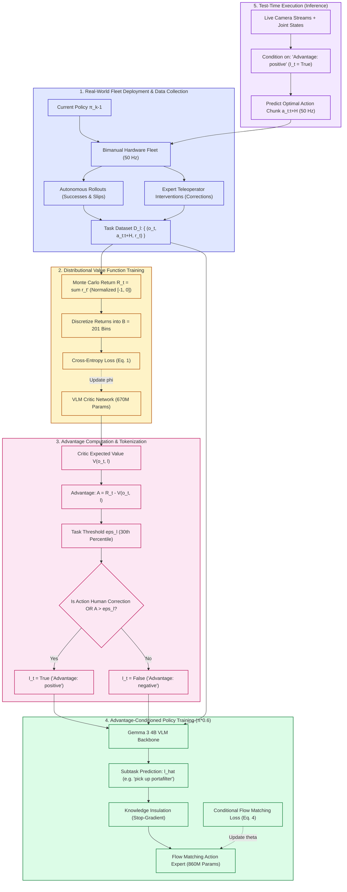
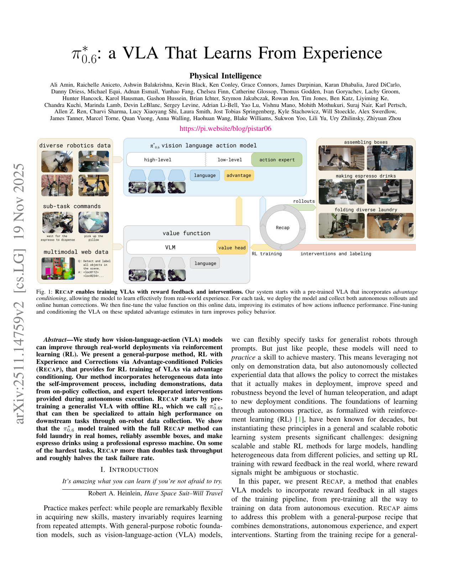
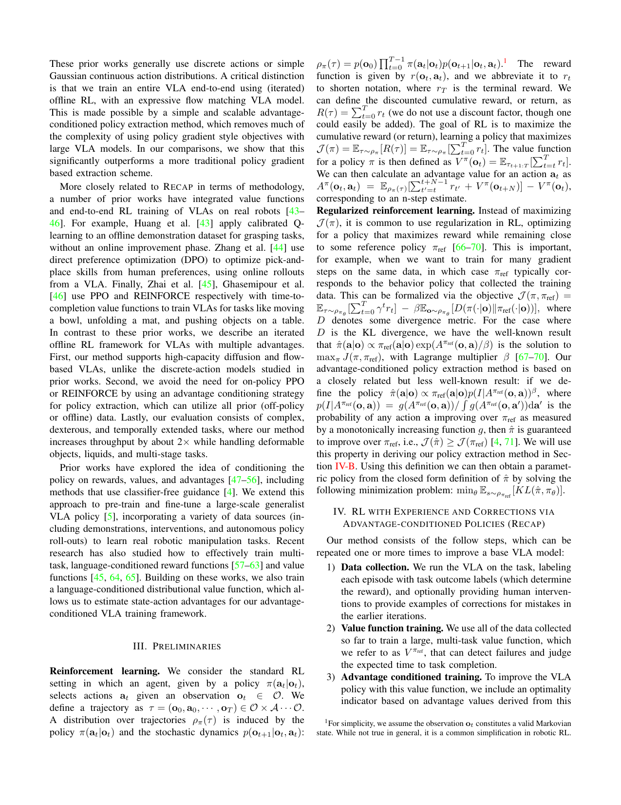
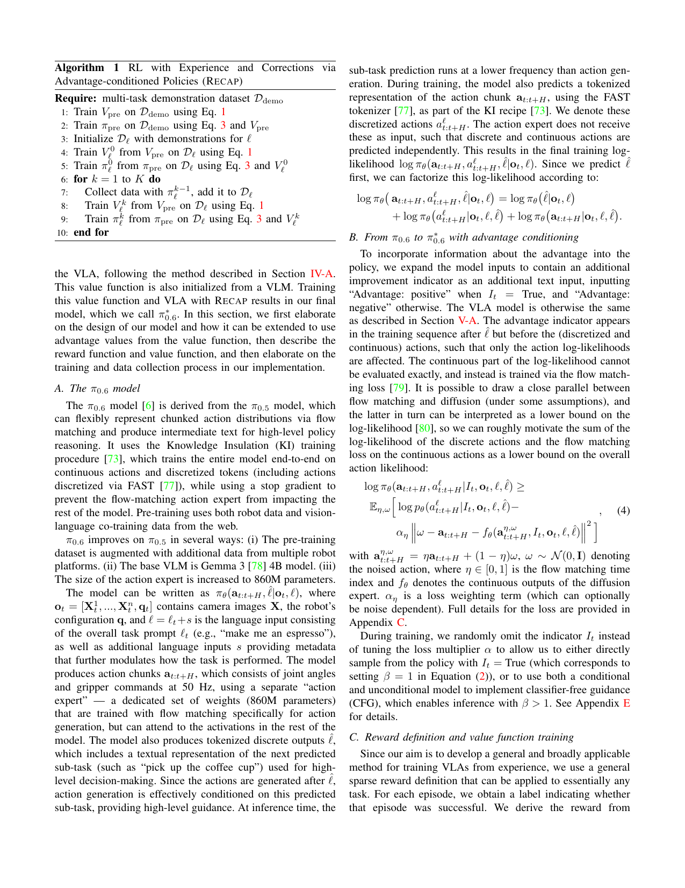
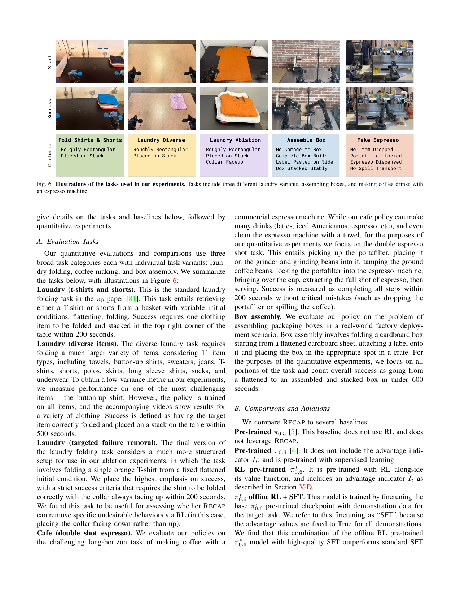
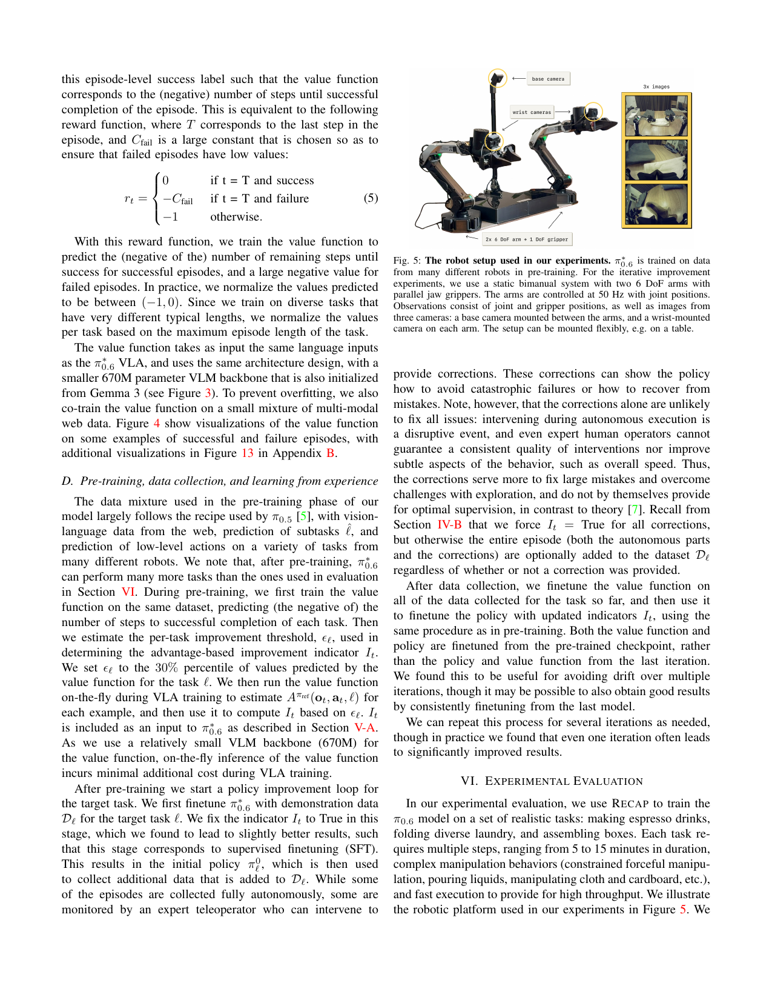
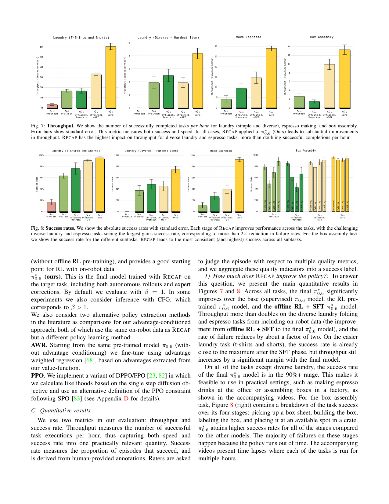

# π*₀.₆: A VLA That Learns From Experience (RECAP)

**[PAPER REVIEW - ARXIV 2025]{.badge .badge-theory}** **[Robotics & Offline RL]{.badge .badge-practice}**

!!! abstract "Executive Summary & Core Delta"
    - **Authors / Venue:** Ali Amin, Ashwin Balakrishna, Chelsea Finn, Karol Hausman, Sergey Levine, et al. (Physical Intelligence) — **arXiv 2025** ([arXiv:2511.14759](https://arxiv.org/abs/2511.14759v2)).
    - **The Bottleneck:** Vision-Language-Action (VLA) models trained purely via imitation learning (Behavioral Cloning) suffer from compounding errors during execution slips, cannot recover from out-of-distribution states, and are fundamentally speed-bounded by human teleoperator hesitation. Scaling standard reinforcement learning to multi-billion-parameter flow-matching VLAs has historically been considered intractable: policy gradients (PPO/REINFORCE) lack tractable action likelihoods over iterative continuous ODE integration; reparameterization backpropagation through time (BPTT) causes gradient explosion and VRAM exhaustion; and weighted regression (AWR) discards valuable autonomous failure data.
    - **The Recommended Solution:** **RECAP** (RL with Experience and Corrections via Advantage-conditioned Policies) decouples value learning from policy extraction. It trains a multi-task distributional critic $V^{\pi_\text{ref}}$ (a 670M parameter VLM) on heterogeneous data (demonstrations, autonomous rollouts, and human interventions) using cross-entropy over 201 discretized return bins. It calculates Monte Carlo advantages $A(o, a) = R - V(o)$ and binarizes them into an optimality token $I \in \{0, 1\}$. The 4B VLA policy ($\pi^*_{0.6}$) is conditioned on this discrete token during supervised flow-matching pre-training and iterative downstream fine-tuning, extracting an improved policy mode at test time by setting $I=\text{True}$ without unstable actor-critic minimax updates.
    - **The Enduring Lecture (Stealable Idea):** To scale RL to massive generative foundation models, do not backpropagate policy gradients through continuous diffusion/flow sampling paths. Decouple value estimation into a lightweight auxiliary model, convert advantages into discrete conditioning tokens, and leverage supervised training across all data (successes, failures, and interventions). Autonomous practice enables robots to systematically outpace human teleoperation speed.

---

## 1. Context, Real-World Scenarios & Problem Motivation

### 1.1 Real-World Application Scenarios

!!! info "From Toy Intuition to Industrial Deployment"
    - **Simple Intuitive Scenario:** Consider a robotic arm folding a t-shirt or operating a manual espresso machine. In demonstration logs, human teleoperators hesitate, jerk the controls, and occasionally drop items. A standard imitation learning policy (BC) faithfully copies human hesitation, resulting in sluggish task completion. When a folded flap springs open or the portafilter misaligns, the robot enters an unvisited state and freezes because demonstrations only contain successful nominal paths. RECAP allows the robot to practice autonomously: when the robot fumbles and recovers (or receives a brief 5-second human nudge), the critic notes the delay and assigns high advantage only to the corrective actions. Across practice cycles, the robot cuts hesitation pauses, doubles throughput, and autonomously recovers from physical slips.
    - **Complex Real-World Industrial Application:** Commercial-Scale Robotic Manipulation in Unstructured Environments (e.g., automated factory box assembly, hotel/laundry folding services, and commercial cafe automation; [Physical Intelligence $\pi_0$](https://pi.website/blog/pistar06); [Open X-Embodiment Collaboration](https://arxiv.org/abs/2310.08864)). In industrial packaging and hospitality, robots face non-rigid, deformable objects (folded cardboard sheets that bind, flexible garments of varying fabrics, and fluid mechanics during espresso extraction). Human teleoperation is prohibitively expensive to maintain at scale and averages only 1 box per hour or 3 espresso shots per hour. RECAP enables continuous multi-robot fleet deployments where models autonomously refine continuous 50 Hz trajectory chunks, achieving 13 hours of continuous espresso making and doubling box assembly throughput to factory-viable speeds.

### 1.2 Direct Problem Evidence & Formalization Overview

Modern robot foundation models combine large vision-language models (VLMs) with generative action heads (diffusion or continuous flow matching) to predict high-frequency action chunks. However, pure imitation learning exhibits three fundamental barriers:

```
                                  THE IMITATION CEILING
Demonstrations ---> Behavioral Cloning ---> Sluggish Execution & Covariate Shift
                           |
                           v  (Prior RL Attempts on VLAs)
    +----------------------+----------------------+----------------------+
    |                      |                      |                      |
    v                      v                      v                      v
PPO / Policy Gradients   Reparameterization BPTT   Weighted Regression    Residual RL
Intractable log-probs    ODE gradient explosion   Discards failure data   Freezes semantic
through continuous ODEs  & GPU memory blowup      & keeps human slowness  VLM backbone
```

1. **The Imitation Learning Ceiling:** Imitation learning is bounded by demonstration quality. Human teleoperators are naturally slow, hesitant, and inconsistent. Furthermore, pure BC suffers from covariate shift ($O(T^2)$ compounding error): once a robot deviates slightly from nominal trajectories, it enters unseen states with catastrophic failure rates.
2. **The Flow-Matching Policy Extraction Trilemma:** Continuous normalizing flows (CNFs) model rich, multimodal action distributions via vector fields $v_\theta(t, s, x_t)$. Differentiating reinforcement learning objectives through multi-step ODE numerical integrations requires Backpropagation Through Time (BPTT), which causes vanishing/exploding gradients and requires gigabytes of activation caching per step. Conversely, standard policy gradient methods (PPO, REINFORCE) require evaluating exact log-likelihoods $\log \pi(a \mid s)$, which requires integrating the divergence of the vector field (trace of the Jacobian) over time via Hutchinson's estimator—computationally prohibitive for 4B+ parameter models in real-time control.
3. **The Suboptimal Data Wastage Problem:** Standard offline RL algorithms (such as Advantage-Weighted Regression / AWR) reweight dataset transitions by exponentiated advantages $\exp(A/\beta)$. In autonomous robotic deployments where robots explore and fail frequently, AWR heavily downweights or discards suboptimal rollouts. This throws away the very failure and recovery data needed to learn error correction.

RECAP resolves this trilemma by replacing iterative policy gradients with **Advantage Conditioning**: training the entire VLA model on all data via supervised flow matching, conditioned on an indicator of whether each action improved upon expected performance.

---

## 2. Theoretical Background, Taxonomy & Prerequisites

### 2.1 Prerequisite Knowledge Map

| Domain | Required Concepts | Why It Is Needed in This Paper |
| :--- | :--- | :--- |
| **Mathematics** | Monte Carlo Return Estimation, Categorical Distributions, Cross-Entropy Loss | Underpins the 201-bin distributional value function $V^{\pi_\text{ref}}$ and the advantage calculation $A = R - V$. |
| **Machine Learning / AI** | Continuous Flow Matching, Classifier-Free Guidance (CFG), Knowledge Insulation | Formulates the continuous action chunk generator, conditional probability extraction via indicator tokens, and isolation of vision-language weights from action gradients. |
| **Robotics & Systems** | Action Chunking, High-Frequency Bimanual Control (50 Hz), Teleoperated Interventions (DAgger) | Defines the hardware deployment framework, camera streaming, proprioceptive state spaces, and human-in-the-loop correction protocols. |

### 2.2 Formal Taxonomy & Notation Table

| Symbol / Term | Domain / Shape | Definition & Role in Paper |
| :--- | :--- | :--- |
| $o_t$ | $[X_1^t, \dots, X_n^t, q_t]$ | Multi-modal observation at time $t$: base and wrist camera RGB images $X$ plus joint/gripper configuration $q$. |
| $\ell = \ell_t + s$ | Text / Token Sequence | Language prompt: high-level task command $\ell_t$ (e.g. `"make espresso"`) plus metadata conditioning tokens $s$. |
| $\hat{\ell}$ | Discrete Tokens | High-level subtask predicted autoregressively by the VLM (e.g. `"pick up portafilter"`), executed at low frequency. |
| $a_{t:t+H}$ | $\mathbb{R}^{H \times d_a}$ (50 Hz) | Continuous action chunk spanning time horizon $H$, predicting target joint angles and gripper states. |
| $a^\ell_{t:t+H}$ | Discrete Tokens | FAST-tokenized discretized representation of the action chunk, predicted for Knowledge Insulation co-training. |
| $\tau$ | Trajectory | Complete episode rollout $(o_0, a_0, r_0, \dots, o_T)$. |
| $R_t(\tau)$ | $\mathbb{R} \in [-1, 0]$ | Empirical Monte Carlo return from step $t$ to horizon $T$, normalized by max task duration. |
| $B$ | $\mathbb{N} = 201$ | Number of discrete return bins used in the distributional value function. |
| $p_\phi(V \mid o_t, \ell)$ | $\Delta^B$ | Distributional value function parameterized by 670M VLM backbone $\phi$, outputting probabilities over bins. |
| $V^{\pi_\text{ref}}(o_t, \ell)$ | $\mathbb{R}$ | Expected return under reference behavior policy: $\sum_{b=0}^B p_\phi(V=b \mid o_t) v(b)$. |
| $A^{\pi_\text{ref}}(o_t, a_t, \ell)$ | $\mathbb{R}$ | Advantage of action $a_t$ relative to reference policy: $R_t(\tau) - V^{\pi_\text{ref}}(o_t, \ell)$. |
| $\epsilon_\ell$ | $\mathbb{R}$ | Task-specific advantage threshold, set to the 30th percentile of predicted task returns. |
| $I_t$ | $\text{Boolean} \in \{0, 1\}$ | Binary improvement indicator: $\mathbf{1}(A^{\pi_\text{ref}} > \epsilon_\ell)$, forced to $\text{True}$ for human corrections. |
| $\pi_\theta$ | 4B VLA + 860M Head | Full policy model predicting subtasks $\hat{\ell}$ and continuous action chunks $a_{t:t+H}$ conditioned on $I_t$. |
| $f_\theta$ | Flow Matching Head | Velocity prediction network in the continuous action expert. |
| $\beta$ | $\mathbb{R}_{\ge 1}$ (Default: 1.0) | Classifier-Free Guidance (CFG) sharpening exponent during test-time action extraction. |

---

## 3. Related Works & Competitive Landscape

| Competing Method | Core Approach | Key Limitation / Failure Mode | How RECAP ($\pi^*_{0.6}$) Differs |
| :--- | :--- | :--- | :--- |
| **Human-Gated DAgger** ([Kelly et al., 2019](https://arxiv.org/abs/1910.04410)) | Interventions triggered on human demand; trains purely via supervised BC on interventions. | Discards autonomous rollouts; cannot improve speed or throughput beyond human teleoperation speed. | Integrates autonomous rollouts and human interventions into a unified offline RL critic; doubles human throughput. |
| **Direct Policy Gradients on VLAs / PPO** ([Zhai et al., 2024](https://arxiv.org/abs/2405.15719); DPPO) | Computes policy gradients (PPO/REINFORCE) directly through VLA action outputs. | Likelihoods are intractable on continuous flow heads; off-policy variance requires ultra-conservative trust regions ($\eta=0.01$) that stunt learning. | Completely eliminates policy gradients; extracts policy via discrete advantage conditioning ($I_t \in \{0, 1\}$). |
| **Advantage-Weighted Regression (AWR / AWAC)** ([Peng et al., 2019](https://arxiv.org/abs/1910.00177)) | Supervised policy updates weighted by exponentiated advantages $\exp(A/\beta)$. | Exponential downweighting discards suboptimal trajectories, behaving like filtered BC and inheriting human hesitation. | Trains on **all** data with supervised flow matching, conditioning on positive vs. negative advantage tokens. |
| **Residual RL & Action Decoupling** ([Johansen et al., 2024](https://arxiv.org/abs/2403.03949)) | Freezes the base VLA and trains a smaller external residual policy for fine-tuning. | Residual head cannot update high-level semantic reasoning or subtask tokens $\hat{\ell}$ when conditions shift. | Updates both semantic subtask tokens and continuous flow matching action heads end-to-end. |

---

## 4. Methodology & Engineering Architecture

### 4.1 Plain-Words Formulation & Data Flow

RECAP operates as an iterative offline RL flywheel that alternates between real-world robot deployment, value function training, and advantage-conditioned policy fine-tuning.




*Figure 1: High-level overview of RECAP. Data is collected via autonomous execution and expert interventions, a distributional value function predicts progress to completion, and the VLA is trained with advantage conditioning.*

### 4.2 Official Mathematical Formulation

#### 1. Reward & Return Formulation
Rewards are formulated with sparse terminal feedback and elapsed time penalties:
$$
r_t = \begin{cases} 
0 & \text{if } t = T \text{ and task succeeds} \\ 
-C_\text{fail} & \text{if } t = T \text{ and task fails} \\ 
-1 & \text{otherwise} 
\end{cases}
$$
The empirical return $R_t(\tau) = \sum_{t'=t}^T r_{t'}$ directly reflects the negative remaining steps until success (penalizing slow execution) and heavily penalizes catastrophic failures via $-C_\text{fail}$. In practice, $R_t(\tau)$ is linearly normalized to $[-1, 0]$ based on the maximum allowed episode horizon.

#### 2. Distributional Value Function Training (Eq. 1)
To capture multimodal return distributions, the normalized return range $[-1, 0]$ is discretized into $B = 201$ uniform bins. The critic $p_\phi(V \mid o_t, \ell) \in \Delta^B$ minimizes the categorical cross-entropy loss over dataset trajectories:
$$
\min_\phi \mathbb{E}_{\tau \sim \mathcal{D}} \left[ \sum_{o_t \in \tau} H\left( R_t^B(\tau),\, p_\phi(V \mid o_t, \ell) \right) \right]
$$
The scalar expected value is extracted via the probability-weighted sum of bin centers $v(b)$:
$$
V^{\pi_\text{ref}}(o_t, \ell) = \sum_{b=0}^B p_\phi(V = b \mid o_t, \ell) \cdot v(b)
$$

#### 3. Advantage Binarization & Task Thresholding
The empirical Monte Carlo advantage is computed as:
$$
A^{\pi_\text{ref}}(o_t, a_t, \ell) = R_t(\tau) - V^{\pi_\text{ref}}(o_t, \ell)
$$
To prevent continuous advantage extrapolation errors during policy deployment, advantages are binarized into an indicator token $I_t \in \{0, 1\}$ using a calibrated task threshold $\epsilon_\ell$:
$$
I_t = \mathbf{1}\left( A^{\pi_\text{ref}}(o_t, a_t, \ell) > \epsilon_\ell \right)
$$
where $\epsilon_\ell$ is set to the 30th percentile of predicted task returns. For teleoperated human corrections provided during autonomous rollouts, the indicator is unconditionally forced to positive:
$$
I_t = \text{True} \quad \forall a_t \in \text{Interventions}
$$

#### 4. Advantage-Conditioned Policy Objective (Eq. 3 & Eq. 4)
The policy maximizes the joint unconditional and conditional action likelihood:
$$
\min_\theta \mathbb{E}_{\mathcal{D}^{\pi_\text{ref}}} \left[ -\log \pi_\theta(a_t \mid o_t, \ell) - \alpha \log \pi_\theta(a_t \mid I_t, o_t, \ell) \right]
$$
Factorizing the model into semantic subtasks $\hat{\ell}$, discrete FAST tokens $a^\ell$, and continuous action chunks $a_{t:t+H}$, the continuous portion is trained via conditional flow matching:
$$
\mathcal{L}_\text{flow}(\theta) = \mathbb{E}_{\eta, \omega} \left[ \alpha_\eta \left\| (\omega - a_{t:t+H}) - f_\theta(a_{t:t+H}^{\eta, \omega},\, I_t, o_t, \ell, \hat{\ell}) \right\|_2^2 \right]
$$
where $a_{t:t+H}^{\eta, \omega} = \eta a_{t:t+H} + (1 - \eta)\omega$ is the noised action chunk with prior noise $\omega \sim \mathcal{N}(0, I)$ and flow time index $\eta \in [0, 1]$.

#### 5. Connection to Classifier-Free Guidance Policy Extraction (Eq. 2)
By Bayes' rule, the advantage-conditioned probability satisfies:
$$
\hat{\pi}(a \mid o, \ell) \propto \pi_\text{ref}(a \mid o, \ell) \left( \frac{\pi_\text{ref}(a \mid I, o, \ell)}{\pi_\text{ref}(a \mid o, \ell)} \right)^\beta
$$
For $\beta = 1$, setting $I=\text{True}$ extracts the improved policy mode $\pi_\text{ref}(a \mid I=\text{True}, o, \ell)$ directly. For $\beta > 1$, classifier-free guidance amplifies the optimal mode at the cost of potential actuator saturation.


*Figure 3: Interaction between the π*₀.₆ VLA and value function during RECAP training. The VLA uses a Gemma 3 4B backbone with an 860M flow action expert isolated by stop-gradients.*

### 4.3 Engineering Solutions & Design Justifications

1. **Distributional 201-Bin Critic vs. Scalar MSE Regression:**
   In real-world robotic tasks with catastrophic failures (e.g. dropping a ceramic mug or tearing a box), outcome distributions are starkly bimodal. Scalar MSE regression computes the arithmetic mean, outputting an intermediate value that obscures risk. A 201-bin categorical cross-entropy head represents multimodal distributions faithfully and eliminates gradient explosions caused by outlier loss penalties.
2. **Binarized Advantage Token ($I_t \in \{0, 1\}$) vs. Continuous Scalar Conditioning:**
   Conditioning diffusion or flow models on continuous scalar advantages causes severe out-of-distribution hallucinations when querying high test-time values ($A = +10.0$). Binarizing into discrete text tokens (`"Advantage: positive"` vs. `"Advantage: negative"`) maps directly into the VLM's existing language embedding space and guarantees that test-time conditioning ($I_t = \text{True}$) stays within well-supported training modes.
3. **Knowledge Insulation (KI) with Stop-Gradients:**
   Backpropagating continuous flow-matching action losses through multi-billion parameter VLM backbones causes catastrophic forgetting of high-level semantic reasoning and vision-language pre-training priors. Knowledge Insulation stops action gradients from penetrating the Gemma 3 backbone, preserving generalist capabilities while specializing the 860M action head.
4. **Asymmetric Model Capacity (670M Critic vs. 4B VLA):**
   Evaluating value functions on-the-fly during policy training would double memory footprints if both models were 4B+. The value function uses a compact 670M VLM backbone initialized from Gemma 3, allowing fast, low-overhead advantage labeling on massive multi-task datasets.

### 4.4 Methodological Pitfalls & Brittle Assumptions

!!! warning "Upfront Methodological Critique"
    - **User-Identified Pitfalls:**
      - The policy relies heavily on the quality and frequency of human interventions during early deployment phases.
      - Training operates in coarse, offline batch cycles rather than continuous online real-time adaptation.
    - **Antigravity Technical Audit:**
      - **Monte Carlo Variance & Dataset Drift:** RECAP uses full-trajectory Monte Carlo returns $R_t(\tau)$ instead of 1-step temporal difference (TD) bootstrapping. While this avoids Q-learning overestimation divergence, Monte Carlo returns exhibit high variance and reflect the behavior of historical, older policies. As the policy improves, older trajectories in $\mathcal{D}$ pull the value function toward an outdated behavioral distribution ($\pi_\text{ref}$ lag).
      - **The Markovian State Assumption (Footnote 1):** The authors explicitly assume single-timestep observations $o_t$ constitute a valid Markov state. In contact-rich manipulation (internal elasticity of cardboard flaps, friction stiction, garment wrinkles, fluid levels in opaque cups), dynamics are partially observable (POMDP). Without recurrent memory or temporal observation histories, the value function cannot distinguish structurally identical camera frames that have different internal stresses.
      - **Heuristic Threshold Sensitivity ($\epsilon_\ell = 30\%$):** The 30th percentile cutoff is fixed uniformly across all tasks. On tasks where 95% of rollouts are catastrophic failures, the top 70% of data still contains flawed behaviors that get labeled as $I_t = \text{True}$, degrading policy quality.
      - **Imperfect Human Takeovers:** Forcing $I_t = \text{True}$ for all human interventions assumes human operators are universally optimal. In practice, teleoperator latency, hand jitter, and abrupt control handoffs introduce noisy trajectories that are erroneously reinforced as high-advantage demonstrations.

---

## 5. Experiments, Evaluation & Results Interrogation

### 5.1 Experimental Setup & Benchmark Audit

- **Physical Robotic Platform (Fig. 5):** Static bimanual manipulation workstation featuring two 6-DoF robot arms equipped with parallel jaw grippers, operated at 50 Hz via joint position control. Visual sensing comprises 3 RGB camera streams: 1 overhead base camera mounted between the arms, and 2 wrist-mounted cameras.
- **Evaluation Tasks (Fig. 6):**
  1. *Laundry (T-shirts & shorts):* Retrieve from bin, unfold, flatten, and stack on table within 200s.
  2. *Diverse Laundry (11 items):* Towels, button-ups, sweaters, jeans, skirts, socks, underwear within 500s (evaluated on button-up shirts).
  3. *Adversarial Laundry (Failure Mode Removal):* Flattened orange t-shirt in an adversarial orientation; strict collar-up constraint within 200s.
  4. *Cafe (Double Shot Espresso):* Pick portafilter, grind beans, tamp, lock into commercial machine, brew shot, pour milk, serve within 200s.
  5. *Box Assembly:* Real-world factory packaging: fold flat cardboard sheet, fold lock flaps, apply label, place in crate within 600s.
- **Metrics:**
  - *Throughput (Tasks/Hour):* Primary holistic metric combining execution speed and success rate.
  - *Success Rate (%):* Strict multi-criteria scoring conducted by human raters.


*Figure 6: Real-world tasks evaluated: laundry folding, factory box assembly, and espresso preparation with a commercial espresso machine.*

### 5.2 Quantitative Results & Ablation Breakdown

#### 1. Policy Extraction Bake-Off (Figure 11)
To isolate the policy extraction mechanism, all methods were evaluated on the T-shirts & Shorts laundry folding task using the exact same on-robot dataset:

| Method | Extraction Mechanism | Success Rate | Throughput (Tasks/Hr) | Relative Throughput |
| :--- | :--- | :---: | :---: | :---: |
| **PPO (DPPO / FPO + SPO)** | Policy Gradients with Trust Region ($\eta=0.01$) | $\approx 65\%$ | $\approx 5.5$ | $-60.7\%$ |
| **AWR** | Advantage-Weighted Supervised Regression | $\approx 80\%$ | $\approx 6.8$ | $-51.4\%$ |
| **Offline RL + SFT (Base)** | Supervised Fine-Tuning on Demonstrations | $\approx 85\%$ | $\approx 9.2$ | $-34.3\%$ |
| **RECAP (Ours, $\beta=1$)** | **Advantage-Conditioned Flow Matching** | **$>90\%$** | **$\approx 14.0$** | **Baseline (+150% vs PPO)** |

*Key finding:* PPO suffered catastrophic instability; clamping the trust region to $\eta = 0.01$ stabilized training but prevented any meaningful policy improvement. AWR achieved decent success (~80%) but produced sluggish, hesitant trajectories (~6.8 tasks/hr). RECAP achieved both the highest success rate and more than double the throughput of AWR.


*Figure 11: Comparison of policy extraction methods on laundry folding. RECAP substantially outperforms AWR and PPO in both success rate and throughput.*

#### 2. Throughput & Success Rate Flywheel (Figures 7, 8, 9, 10)
Across all evaluated domains, RECAP produced massive gains over standard supervised fine-tuning (SFT):
- **Throughput Doubling on Complex Domains:**
  - *Espresso Making:* Rose from $\approx 3.0$ tasks/hr to **$\approx 7.0$ tasks/hr** ($>130\%$ throughput gain).
  - *Diverse Laundry:* Rose from $\approx 1.5$ tasks/hr to **$\approx 3.8$ tasks/hr** ($>150\%$ throughput gain).
  - *Box Assembly:* Rose from $\approx 1.0$ task/hr to **$\approx 2.2$ tasks/hr** ($>120\%$ throughput gain).
- **Failure Rate Reductions:** Task failure rates were cut by more than half across the board (e.g., espresso failures dropped from $>60\%$ to $<10\%$).
- **Endurance Stress Test:** The trained model achieved **13 consecutive hours** of continuous espresso preparation and **2 consecutive hours** of autonomous laundry folding in a novel real-world home without human interventions.


*Figures 7 & 8: Quantitative comparison across laundry, espresso, and box assembly. RECAP more than doubles throughput on the hardest tasks and reduces failure rates by over 2x.*

#### 3. Targeted Failure Mode Removal (Figure 12)
On an adversarial orange t-shirt setup where baseline SFT consistently folded the collar facing down, RECAP was applied across 2 iterations (600 trajectories per iteration) using **100% autonomous rollouts with zero human interventions and zero demonstrations**. The resulting policy achieved **97% strict success**, proving that reward-driven practice autonomously eliminates undesirable behavioral modes.


*Figure 12: Autonomous elimination of specific failure modes without human intervention data.*

!!! tip "Visualization & Reporting Audit"
    - **What the Authors Highlighted:** Substantial throughput doubling, 13-hour physical endurance records, clean removal of specific behavioral flaws, and clear superiority of advantage conditioning over AWR and PPO.
    - **What Was Downplayed / Ignored:**
      1. *High Human Labor Overhead:* Box assembly required 360 human teleoperated intervention trials alongside 600 autonomous trials in every iteration, representing dozens of hours of manual piloting.
      2. *Proxy Metric Selection:* The 11-item "diverse laundry" benchmark was quantitatively evaluated solely on button-up shirts to reduce metric variance.
      3. *Lack of Standard Training Curves:* The paper omits standard offline RL training curves (e.g. value MSE, Bellman residual loss, policy entropy across gradient steps), making it difficult to assess optimization convergence.

---

## 6. Conclusions, Limitations & Future Trajectory

### 6.1 Clear Wins & Practical Application Lecture

1. **Advantage Conditioning Over Policy Gradients for Large Models:** Differentiating through multi-step generative ODE/SDE sampling paths or calculating continuous action likelihoods is a dead end for multi-billion-parameter foundation models. Decouple value learning into a smaller critic, binarize advantages into discrete prompt tokens, and train the generator with supervised flow matching.
2. **Suboptimal Data is an Asset, Not Waste:** Throwing away failure data (as done in filtered BC or aggressive AWR) deprives the robot of learning error recovery. Retaining all trajectories while conditioning on advantage allows policies to learn both nominal execution and recovery behaviors.
3. **Autonomous Practice Breaks the Human Teleoperation Speed Limit:** Human teleoperation contains reaction delays, jerky corrections, and hesitation. Through reward-guided reinforcement learning, robots cut out hesitation pauses, executing fluent continuous trajectories that double human throughput.

### 6.2 Unmentioned Limitations & Future Work Verdict

- **Authors' Stated Future Work:** Developing automated scene reset policies using high-level VLAs, moving from batch-offline retraining to streaming real-time online RL, and incorporating active exploration.
- **Critical Verdict (Worth Pursuing?):**
  - *Extremely High Value:* Autonomous environment resets via high-level agentic subtask policies (e.g. using an auxiliary robot arm to reset boxes or restock coffee beans). Without automated resets, fleet data collection remains bound to human lab assistants.
  - *High Value:* Streaming asynchronous online RL updates to eliminate the multi-hour lag between rollout collection and model retraining.
  - *Missing Priority:* Action Chunk Horizon adaptation. The model uses a fixed chunk horizon $H$; dynamic chunking based on critic uncertainty would allow the robot to move rapidly during open-space free motion while slowing down and tightening closed-loop feedback during delicate contact phases (e.g. portafilter locking).

---

## 7. Follow-Up Action Items (From the Parking Lot)

<details markdown="1">
<summary>Prerequisite Concepts & Priority Citations to Triage Next</summary>

- **Concepts Clarified:**
  1. **Knowledge Insulation (KI):** A multi-task VLA training strategy that separates discrete reasoning tokens from continuous action generation using explicit stop-gradients. This ensures continuous robotic control losses do not corrupt or degrade pretrained vision-language representations.
  2. **FAST Tokenizer (Frequency-Aware Action Space Tokenization):** A byte-pair-encoding style algorithm that adaptively discretizes continuous multi-dimensional robot trajectory chunks into compact token sequences, allowing autoregressive transformers to model continuous physical control.
  3. **Classifier-Free Guidance RL (CFGRL):** A policy extraction framework based on generative diffusion/flow models that trains on both conditional and unconditional data. At test time, conditioning on positive return or advantage tokens extracts high-performing policy modes without explicit policy gradient updates.

- **Next Papers for a 10-Minute Triage Pass:**
  1. `[Black et al., 2024]` **$\pi_0$: A Vision-Language-Action Flow Model for Generalist Robot Control:** The seminal predecessor establishing the flow-matching action-expert architecture used in $\pi_{0.6}$.
  2. `[Physical Intelligence, 2026]` **RL Token: Bootstrapping Online RL with Vision-Language-Action Models:** Paper #4 in our reading backlog; explores dedicated tokenization for online VLA actor-critic alignment.

</details>

