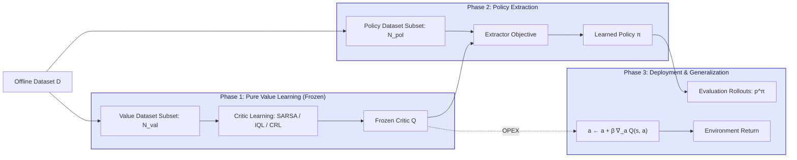
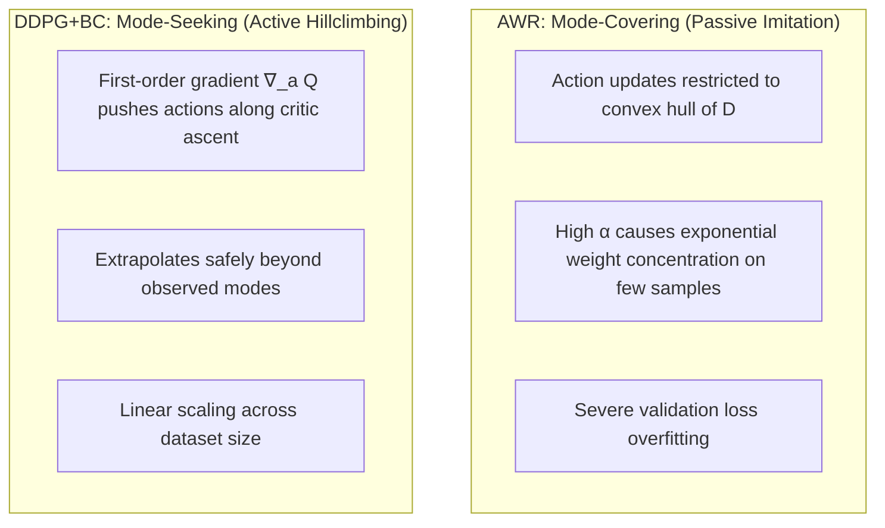
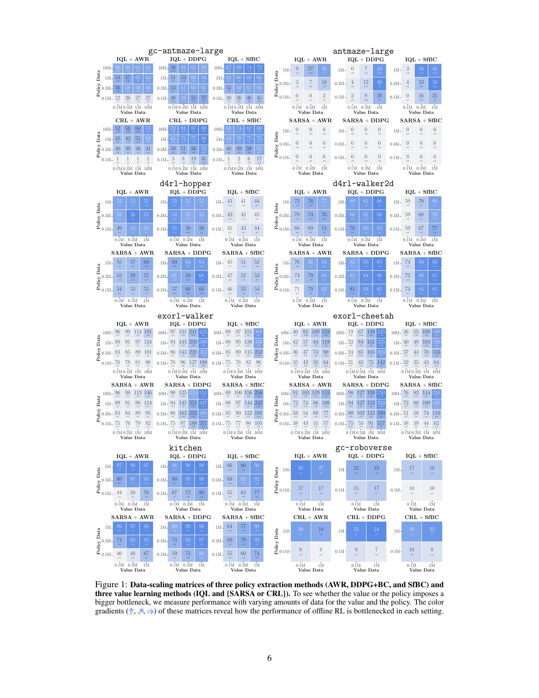
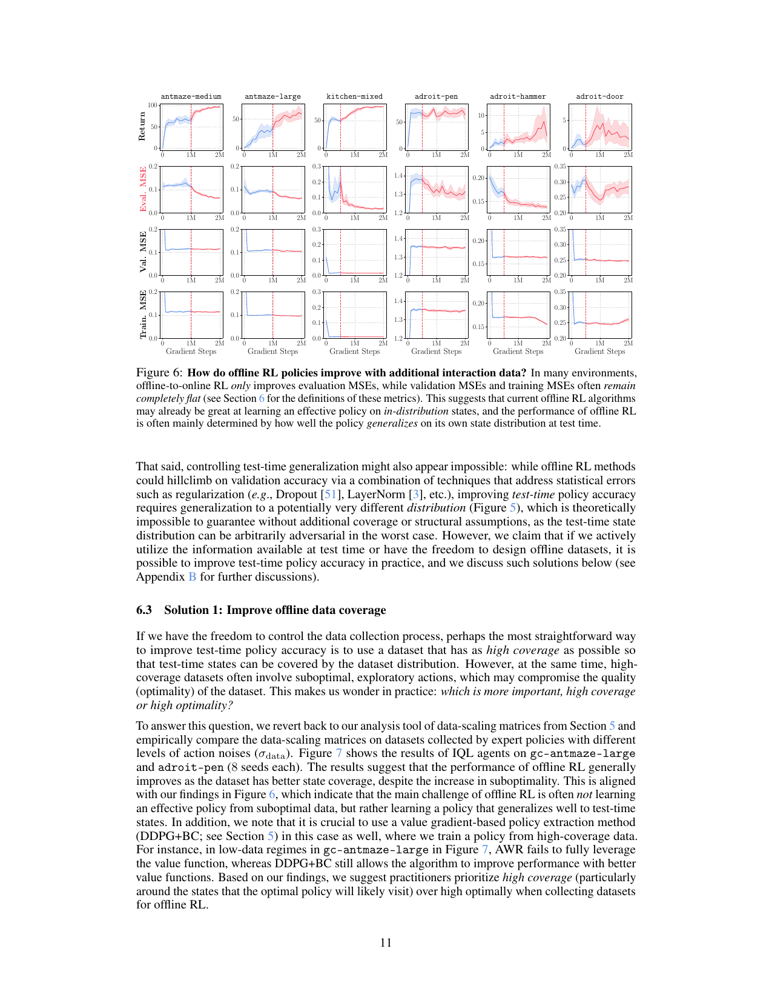
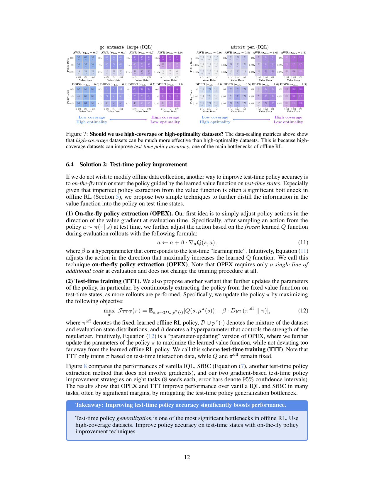
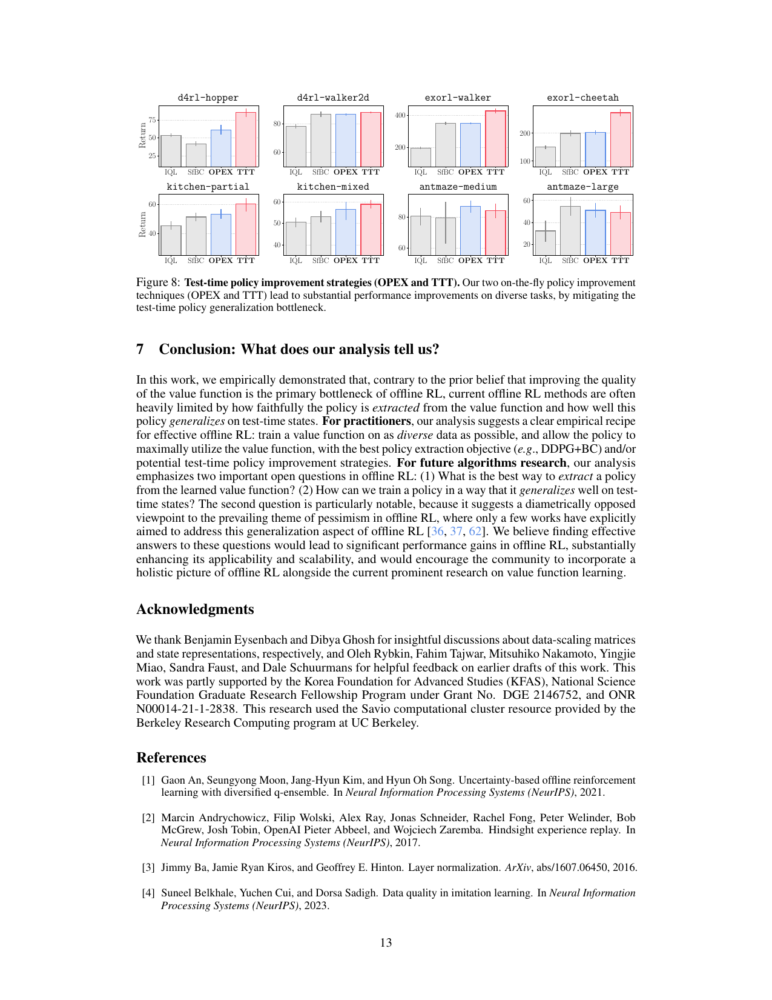

# Is Value Learning Really the Main Bottleneck in Offline RL?

**[PAPER REVIEW - NEURIPS 2024]{.badge .badge-theory}** **[Offline Reinforcement Learning]{.badge .badge-practice}**

!!! abstract "Executive Summary & Core Delta"
    - **Authors / Venue:** Seohong Park (UC Berkeley), Kevin Frans (UC Berkeley), Sergey Levine (UC Berkeley), Aviral Kumar (Carnegie Mellon University) — **NeurIPS 2024** ([arXiv:2406.09329](https://arxiv.org/abs/2406.09329)).
    - **The Bottleneck:** Conventional offline RL research attributes degraded performance and the gap relative to imitation learning primarily to **imperfect value function estimation** (e.g. Bellman error accumulation, out-of-distribution value overestimation, and representation collapse). Consequently, the community has poured effort almost exclusively into designing conservative or in-sample value objectives while treating policy extraction as an afterthought.
    - **The Recommended Solution:** Through large-scale empirical audits across 15,488 runs with decoupled value-policy training, the authors demonstrate that **policy extraction** and **test-time policy generalization** (generalizing to unvisited rollout states at deployment) are often the true performance choke points. Switching from weighted behavioral cloning (e.g., AWR) to behavior-constrained policy gradients (e.g., DDPG+BC) dramatically boosts data scaling. Furthermore, collecting high-coverage exploratory data and applying test-time policy improvement—such as **On-the-fly Policy Extraction (OPEX)** and **Test-Time Training (TTT)**—directly mitigates test-time generalization bottlenecks.
    - **The Enduring Lecture (Stealable Idea):** In continuous offline RL, avoid pure weighted behavioral cloning on multi-modal or expressive architectures; use behavior-regularized policy gradients that hillclimb the critic beyond the dataset convex hull. When building datasets, prioritize broad state coverage over expert optimality.

---

## 1. Context, Real-World Scenarios & Problem Motivation

### 1.1 Real-World Application Scenarios

!!! info "From Toy Intuition to Industrial Deployment"
    - **Simple Intuitive Scenario:** Consider training a 2D continuous navigation agent in a multi-room environment from historical teleoperation logs. The human operator drove near the perimeter walls. Standard in-sample value learning (e.g., IQL) successfully estimates that cutting through the center room yields high return. However, if the policy is extracted using Advantage-Weighted Regression (AWR), the policy is constrained to the convex hull of demonstrated perimeter actions—it can only replay wall-following behavior. When deployed, small actuator disturbances push the robot into the open center, a state not present in the offline logs. The policy halts or oscillates because it never learned to generalize to unseen test states, despite the critic having adequate value information. Under DDPG+BC with OPEX ($a \leftarrow a + \beta \nabla_a Q(s,a)$), the robot uses the critic's gradient field to steer straight through the center toward the goal.
    - **Complex Real-World Application:** Automated Warehouse Robotic Manipulation & Autonomous Driving Post-Training (e.g., [Open X-Embodiment Collaboration, 2024](https://arxiv.org/abs/2310.08864); [Mandlekar et al., 2021](https://arxiv.org/abs/2108.03298)). Industrial robotics pipelines aggregate petabytes of suboptimal teleoperation trajectories, automated script logs, and failed grasp attempts. Training offline RL policies on these diverse datasets is critical because online trial-and-error risks hardware collisions. While critics trained on these massive logs often capture actionable Q-values, standard policy extraction mechanisms fail to generalize when novel object configurations or camera lighting shifts arise at deployment. By prioritizing broad exploratory coverage over curated expert demonstrations and employing test-time value guidance, robotic policies maintain robust grasp trajectories on unseen deployment states.

### 1.2 Direct Problem Evidence & Formalization Overview

Offline reinforcement learning converts static historical datasets $\mathcal{D} = \{\tau_i\}_{i=1}^N$ into decision-making policies $\pi(a \mid s)$ without online environment interaction. Historically, offline RL's central pathology was identified as **distributional shift**: when evaluating candidate actions, the Bellman target queries actions unobserved in $\mathcal{D}$, causing function approximators to output wildly inflated Q-values ([Levine et al., 2020](https://arxiv.org/abs/2005.01643)).

To address this, the field produced conservative algorithms:
- **Pessimistic Penalties:** Conservative Q-Learning (CQL; [Kumar et al., 2020](https://arxiv.org/abs/2006.04779)), TD3+BC ([Fujimoto & Gu, 2021](https://arxiv.org/abs/2106.06860)).
- **In-Sample Expectile Operators:** Implicit Q-Learning (IQL; [Kostrikov et al., 2022](https://arxiv.org/abs/2110.06169)).
- **Contrastive Representations:** Contrastive RL (CRL; [Eysenbach et al., 2022](https://arxiv.org/abs/2206.07568)).

Despite these advances, tuned Behavioral Cloning (BC) on high-quality demonstrations frequently outperforms sophisticated offline RL methods in practice ([Belkhale et al., 2023](https://arxiv.org/abs/2307.08751)). Park et al. investigate whether this deficit stems from remaining value errors or from how policies are extracted and deployed. They decompose the offline RL pipeline into three potential bottlenecks:

1. **(B1) Imperfect Value Estimation:** Failure of the critic to approximate $Q^*$ or $Q^\beta$ from the offline data.
2. **(B2) Imperfect Policy Extraction:** Failure of the policy optimization objective to extract the best actions guided by the learned critic.
3. **(B3) Imperfect Policy Generalization:** Failure of the extracted policy to output accurate actions on the out-of-distribution state distribution $p^\pi(s)$ visited during evaluation rollouts.

---

## 2. Theoretical Background, Taxonomy & Prerequisites

### 2.1 Prerequisite Knowledge Map

| Domain | Required Concepts | Why It Is Needed in This Paper |
| :--- | :--- | :--- |
| **Mathematics** | Expectile regression, Asymmetric least squares, Convex hulls | Underpins IQL value estimation ($\ell_\tau^2$) and explains why AWR actions remain trapped inside observed action convex hulls. |
| **Machine Learning / AI** | Mode-covering vs. mode-seeking objectives, KL divergence, Deterministic Policy Gradients | Explains the structural divergence between Advantage-Weighted Regression (AWR) and DDPG+BC actor extraction. |
| **Computer Science / Systems** | Decoupled offline architectures, Test-time gradient backpropagation | Required to isolate value data from policy data scaling and to execute on-the-fly action optimization (OPEX) during evaluation rollouts. |

### 2.2 Formal Taxonomy & Notation Table

| Symbol / Term | Domain / Shape | Definition & Role in Paper |
| :--- | :--- | :--- |
| $\mathcal{M}$ | $(\mathcal{S}, \mathcal{A}, r, \mu, p, \gamma)$ | Standard Markov Decision Process. |
| $\mathcal{D}$ | $\{\tau_i\}_{i=1}^N$ | Static offline dataset of trajectories $\tau = (s_0, a_0, r_0, s_1, \dots)$. |
| $Q^\beta(s, a)$ | $\mathcal{S} \times \mathcal{A} \rightarrow \mathbb{R}$ | Behavioral state-action value function estimating the expected return under the dataset policy $\pi^\beta$. |
| $Q^*(s, a)$ | $\mathcal{S} \times \mathcal{A} \rightarrow \mathbb{R}$ | Optimal Bellman state-action value function. |
| $\ell_\tau^2(u)$ | $\mathbb{R} \rightarrow \mathbb{R}_{\ge 0}$ | Asymmetric expectile loss: $|\tau - \mathbf{1}(u < 0)| u^2$, where $\tau \in (0, 1)$ governs optimism. |
| $\alpha$ | $\mathbb{R}_{> 0}$ | Temperature / regularization coefficient interpolating between RL value maximization and behavioral cloning. |
| $\beta$ | $\mathbb{R}_{> 0}$ | Test-time learning rate (in OPEX) or KL regularizer strength (in TTT). |
| $\text{OPEX}$ | Algorithmic Hook | On-the-fly Policy Extraction: adjusts sampled actions along $\nabla_a Q(s, a)$ at test time. |
| $\text{TTT}$ | Algorithmic Hook | Test-Time Training: fine-tunes policy parameters on evaluation rollout states regularized against offline $\pi^{\text{off}}$. |
| $p^\pi(s)$ | $\Delta(\mathcal{S})$ | State visitation distribution induced by rolling out policy $\pi$ in the environment during evaluation. |

---

## 3. Related Works & Competitive Landscape

| Competing Method / Study | Core Approach | Key Limitation / Failure Mode | How This Paper Differs |
| :--- | :--- | :--- | :--- |
| **Fu et al. (2022)** [13] | Empirical analysis of offline RL representations and value accuracy on D4RL. | Examined only locomotion tasks with static dataset splits; did not evaluate policy data scaling or test-time rollout generalization. | Evaluates 8 diverse domains (goal-conditioned, pixel manipulation, ExORL), systematically sweeps 2D data-scaling matrices, and identifies policy generalization as a primary bottleneck. |
| **Implicit Q-Learning (IQL)** [24] | In-sample expectile regression for $V(s)$ combined with AWR policy extraction. | Pairs a strong in-sample critic with weighted BC (AWR), which collapses and overfits when policy temperature $\alpha$ is increased. | Demonstrates that IQL's bottleneck is AWR extraction; replacing AWR with DDPG+BC unlocks substantial performance gains from the exact same IQL critic. |
| **TD3+BC / DDPG+BC** [14] | Behavior-regularized deterministic policy gradient coupled with on-policy TD3 critic learning. | Evaluated primarily as an interleaved actor-critic method on standard locomotion datasets without isolating data scaling. | Decouples DDPG+BC policy extraction from frozen critics (SARSA, IQL, CRL) and demonstrates its superior mode-seeking behavior across data-scaling grids. |

---

## 4. Methodology & Engineering Architecture

### 4.1 Plain-Words Formulation & Data Flow

To isolate value learning from policy extraction without confounding feedback loops, the authors evaluate **decoupled offline RL**:

1. **Phase 1 (Value Learning):** Train a value function ($Q$ or $V$) on $N_{\text{value}}$ transitions using an objective that involves **no policy learning**:
   - **SARSA (Eq. 1):** $\min_Q \mathbb{E}_{(s,a,s',a') \sim \mathcal{D}} [(r(s, a) + \gamma \bar{Q}(s', a') - Q(s, a))^2]$ (evaluates $Q^\beta$ directly without out-of-distribution action queries).
   - **IQL (Eq. 2–3):** Expectile regression fitting $V(s) \approx \max_a Q(s, a)$ purely in-sample.
   - **CRL (Eq. 4):** Contrastive future state classification for goal-conditioned tasks.
2. **Phase 2 (Policy Extraction):** Freeze the critic and train an actor policy $\pi(a \mid s)$ on $N_{\text{policy}}$ transitions using the learned critic.
3. **Phase 3 (Deployment / Evaluation):** Evaluate the policy in the real environment. Optionally apply on-the-fly test-time adjustments (OPEX or TTT) to combat rollout distribution shift.

### 4.2 Official Mathematical Formulation

#### Policy Extraction Objectives

**1. Advantage-Weighted Regression (AWR):**
$$
\max_\pi \mathcal{J}_{\text{AWR}}(\pi) = \mathbb{E}_{(s,a) \sim \mathcal{D}} \left[ \exp\left(\alpha (Q(s, a) - V(s))\right) \log \pi(a \mid s) \right]
$$
AWR performs supervised imitation, weighting transitions by exponentiated advantage.

**2. Behavior-Constrained Policy Gradient (DDPG+BC):**
$$
\max_\pi \mathcal{J}_{\text{DDPG+BC}}(\pi) = \mathbb{E}_{s, a \sim \mathcal{D}} \left[ Q(s, \mu^\pi(s)) + \alpha \log \pi(a \mid s) \right]
$$
where $\mu^\pi(s) = \mathbb{E}_{a \sim \pi(\cdot \mid s)}[a]$. DDPG+BC directly maximizes the critic via first-order policy gradients while regularizing toward observed dataset actions.

**3. Sampling-filtered BC (SfBC):**
$$
\pi(s) = \arg\max_{a \in \{a_1, \dots, a_N\}} Q(s, a), \quad a_i \sim \pi^\beta(\cdot \mid s)
$$

---

#### Test-Time Policy Improvement

**1. On-the-fly Policy Extraction (OPEX):**
$$
a \leftarrow a + \beta \cdot \nabla_a Q(s, a)
$$
After sampling $a \sim \pi(\cdot \mid s)$ during evaluation, a single gradient ascent step along the frozen critic's action gradient adjusts the action toward higher value.

**2. Test-Time Training (TTT):**
$$
\max_\pi \mathcal{J}_{\text{TTT}}(\pi) = \mathbb{E}_{s, a \sim \mathcal{D} \cup p^\pi(\cdot)} \left[ Q(s, \mu^\pi(s)) - \beta \cdot D_{\text{KL}}(\pi^{\text{off}} \parallel \pi) \right]
$$
Continuously fine-tunes policy weights on the mixture of dataset and rollout states, regularized against the frozen offline policy $\pi^{\text{off}}$.

---

### 4.3 Engineering Solutions & Design Justifications

- **Why DDPG+BC Outperforms AWR:**
  1. **Mode-Seeking vs. Mode-Covering:** AWR minimizes $\mathbb{E}[D_{\text{KL}}(\pi^\beta \parallel \pi)]$, forcing the policy to cover the convex hull of demonstrated actions (Figure 3 in paper). DDPG+BC performs first-order hillclimbing along $\nabla_a Q(s, \cdot)$, allowing controlled extrapolation beyond demonstrated actions.
  2. **Effective Sample Collapse:** In AWR, when temperature $\alpha$ is high, a tiny fraction of transitions with high advantage dominates the loss ($\exp(10)$ dwarfs $\exp(2)$), effectively starving the policy of training samples and causing catastrophic validation overfitting (Figure 4 in paper). DDPG+BC optimizes unweighted gradients and utilizes the entire dataset smoothly.
  3. **Action Clipping over Tanh Squashing:** In DDPG+BC, the authors clip actions to $[-1, 1]$ during the policy gradient update rather than applying $\tanh$ squashing, avoiding gradient saturation at boundary limits.

---

### 4.4 Methodological Pitfalls & Brittle Assumptions

!!! warning "Upfront Methodological Critique"
    - **Continuous-Action Limitation:** DDPG+BC and OPEX rely on computing continuous action gradients $\nabla_a Q(s, a)$. Neither applies directly to discrete action domains (e.g. discrete robot macros, Atari, or text token generation).
    - **Inference Latency & Control Stability:** OPEX requires computing a full backpropagation pass through the critic network to obtain $\nabla_a Q(s, a)$ **at every control cycle during deployment**. In high-frequency physical robotics (e.g. 100 Hz–1 kHz motor controllers) or gravity-dominated dynamic maneuvers, this computational delay can destabilize the control loop.
    - **Antigravity Technical Audit (Hyperparameter Asymmetry):** In Figure 1 and Table 1, the policy extraction hyperparameter ($\alpha$ or $N$) is individually tuned per matrix cell over 8 seeds to report the best envelope. However, practitioners in real-world offline RL cannot perform online grid sweeps to select optimal temperatures without online rollouts.

---

## 5. Experiments, Evaluation & Results Interrogation

### 5.1 Experimental Setup & Benchmark Audit

The empirical audit spans **8 environments** and 15,488 training runs (Figure 10 in paper):
- **Continuous Locomotion & Manipulation (D4RL):** `antmaze-large`, `d4rl-hopper`, `d4rl-walker2d`, `kitchen`.
- **Exploratory & Suboptimal Unsupervised Data (ExORL):** `exorl-walker`, `exorl-cheetah` (collected via RND exploratory agents).
- **Goal-Conditioned & Visual Tasks:** `gc-antmaze-large` (10M transitions), `gc-roboverse` ($48 \times 48 \times 3$ pixel observations).

*Figure 1 from Park et al. (2024): Data-scaling matrices for AWR, DDPG+BC, and SfBC across value learning objectives (IQL, SARSA, CRL).*

---

### 5.2 Policy Generalization Audit: The MSE Diagnostic

To test hypothesis (B3), the authors evaluate offline-to-online IQL policies across six D4RL tasks and monitor three distinct policy Mean Squared Error (MSE) metrics against an oracle policy $\pi^*$:

$$\text{Train MSE} = \mathbb{E}_{\mathcal{D}_{\text{train}}}[(\pi(s) - \pi^*(s))^2], \quad \text{Val MSE} = \mathbb{E}_{\mathcal{D}_{\text{val}}}[(\pi(s) - \pi^*(s))^2], \quad \text{Eval MSE} = \mathbb{E}_{s \sim p^\pi}[(\pi(s) - \pi^*(s))^2]$$

*Figure 6 from Park et al. (2024): During online interaction, training and validation MSE remain flat, while Evaluation MSE plummets in tandem with environment return.*

!!! tip "Key Empirical Finding: In-Distribution Fit is Saturated"
    Modern offline RL algorithms already learn near-optimal actions on the training distribution $\mathcal{D}$. Performance during evaluation is dictated by how well the policy generalizes to out-of-distribution states encountered in test rollouts ($p^\pi(s)$).

---

### 5.3 Coverage vs. Optimality & Test-Time Adaptation

*Figure 7 from Park et al. (2024): High-coverage datasets with substantial noise ($\sigma_{\text{data}} = 1.0$) outperform clean, low-coverage expert datasets.*

*Figure 8 from Park et al. (2024): Performance of vanilla IQL vs. SfBC, OPEX, and TTT across 8 benchmarks.*

!!! tip "Visualization & Reporting Audit"
    - **What the Authors Highlighted:**
      - DDPG+BC beats AWR in **15 out of 16 settings** (Table 1), often doubling performance on exploratory datasets like ExORL (`exorl-walker`: 191 vs. 425).
      - Noisy exploratory data yields higher final return than expert demonstrations by expanding state support (Figure 7).
      - OPEX and TTT boost performance without retraining value functions (Figure 8).
    - **What Was Downplayed / Nuanced:**
      - **Value Learning Still Dominates in Key Regimes:** In `antmaze-large`, SARSA scores a flat **$0 \pm 0$** across the board because it cannot stitch trajectories without Bellman optimality. On `exorl-walker`, scaling value data from 0.1M to 10M drives return from 97 to 425. Value data scaling is therefore essential for hard credit assignment.
      - **Statistical Reporting Deficiency:** Results are reported as mean $\pm$ standard deviation across 8 seeds. The paper lacks modern stratified bootstrap confidence intervals, aggregate Interquartile Means (IQM), or probability of improvement metrics (e.g. *rliable*).

---

## 6. Conclusions, Limitations & Future Trajectory

### 6.1 Clear Wins & Practical Application Lecture

1. **Retire Pure Weighted BC (AWR):** In continuous offline RL architectures (such as `src/olp/agents/`), avoid advantage-weighted behavioral cloning on complex policies. Default to **DDPG+BC** with action clipping in $[-1, 1]$.
2. **Prioritize Exploratory Data Coverage:** When logging offline trajectories for pre-training or fine-tuning, do not filter out noisy or suboptimal rollouts. State-space coverage around deployment paths is far more valuable than pristine optimality.
3. **Deploy Test-Time Gradient Steerability:** When deploying continuous actor-critics, consider adding an OPEX evaluation step ($a \leftarrow a + \beta \nabla_a Q(s, a)$) if real-time compute latency permits.

### 6.2 Unmentioned Limitations & Future Work Verdict

- **Authors' Proposed Direction:** Shift community research away from value function pessimism and toward **policy extraction algorithms and test-time policy generalization** on out-of-distribution states.
- **Critical Verdict:** Highly promising and pragmatic paradigm shift. However, future work must resolve:
  1. Applying gradient-guided policy extraction to **discrete action spaces**.
  2. Mitigating inference latency of test-time critic backpropagation in high-frequency real-time physical control.
  3. Evaluating test-time generalization without relying on unrealistic expert oracle policies $\pi^*$.

---

## 7. Follow-Up Action Items (From the Parking Lot)

Prerequisite Concepts & Priority Citations to Triage Next

- **Concepts Clarified:**
  1. **In-Sample Expectile Regression (IQL) vs. Contrastive RL (CRL):** IQL uses an asymmetric loss $\ell_\tau^2(u) = |\tau - \mathbf{1}(u < 0)| u^2$ with $\tau \in (0.5, 1.0)$ to estimate an upper expectile of $Q$, approximating $\max_a Q(s,a)$ without evaluating unobserved actions. CRL reframes goal-conditioned RL as self-supervised representation learning, predicting whether a state $g$ will be visited in the geometric future via a sigmoid cross-entropy objective, eliminating Bellman bootstrapping altogether.
  2. **Mode-Covering (AWR) vs. Mode-Seeking (DDPG+BC):** Weighted BC minimizes forward KL divergence $\mathbb{E}[D_{\text{KL}}(\pi^\beta \parallel \pi)]$, forcing the policy to stretch its mass across all positive-advantage dataset actions (trapping it in their convex hull). DDPG+BC uses reverse policy gradients $\nabla_a Q(s, a)$ to push the actor toward the highest local mode of the critic while penalizing divergence from the data via a supervised loss.
- **Next Papers for a 10-Minute Triage Pass:**
  1. `[Kostrikov et al., 2022]` **Offline Reinforcement Learning with Implicit Q-Learning (IQL):** Essential foundation for understanding how in-sample value estimation avoids out-of-distribution action queries.
  2. `[Fujimoto & Gu, 2021]` **A Minimalist Approach to Offline Reinforcement Learning (TD3+BC):** Details the exact implementation, normalization, and balance of deterministic policy gradients with behavioral cloning.

