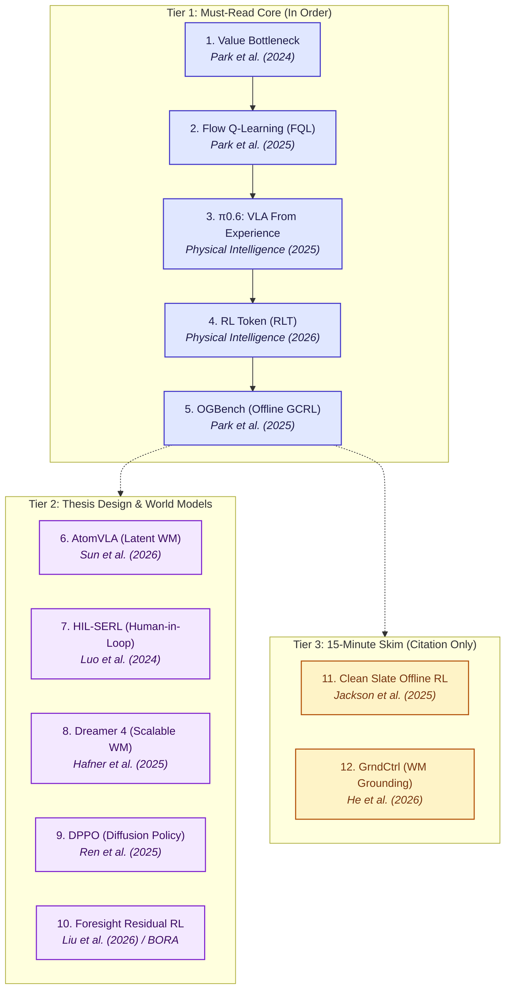

# Research Reading Backlog

**[ACTIVE RESEARCH ROADMAP]{.badge .badge-exam}** **[12 PAPERS]{.badge .badge-workshop}** **[OFFLINE RL & WORLD MODELS]{.badge .badge-madeup}**

This living reading backlog organizes essential literature supporting the **Offline Learning Playground (OLP)** and thesis research on model-based offline reinforcement learning, flow/diffusion policies, scalable world models, and vision-language-action (VLA) post-training.

All deep-read entries (Tiers 1 & 2) follow the **60-minute active reading protocol**, transitioning from `research_staging/` to permanent documentation under `docs/knowledge_base/research/`.

---

## Roadmap & Reading Flow



---

## Reading Backlog Matrix

| # | Priority Tier | Paper Key | Core Topic / Architecture | Proposed Slug | Protocol | Status |
| :-: | :--- | :--- | :--- | :--- | :--- | :---: |
| 1 | **Tier 1 (Core)** | [arXiv:2406.09329](https://arxiv.org/abs/2406.09329) | Value learning vs. actor extraction bottleneck | `value_learning_bottleneck_park_et_al_2024` | 60-min Deep Read | ⏳ Next Up |
| 2 | **Tier 1 (Core)** | [arXiv:2502.02538](https://arxiv.org/abs/2502.02538) | Flow matching policy optimization (FQL) | `flow_q_learning_park_et_al_2025` | 60-min Deep Read | 📋 Queued |
| 3 | **Tier 1 (Core)** | [arXiv:2511.14759](https://arxiv.org/abs/2511.14759) | VLA learning from autonomous experience | `pi06_vla_physical_intelligence_2025` | 60-min Deep Read | 📋 Queued |
| 4 | **Tier 1 (Core)** | [PI-2026-RLT](https://www.pi.website/download/rlt.pdf) | RL Token for online VLA bootstrapping | `rl_token_physical_intelligence_2026` | 60-min Deep Read | 📋 Queued |
| 5 | **Tier 1 (Core)** | [arXiv:2410.20092](https://arxiv.org/abs/2410.20092) | Offline Goal-Conditioned RL benchmark suite | `ogbench_park_et_al_2025` | 60-min Deep Read | 📋 Queued |
| 6 | **Tier 2 (Thesis)** | [arXiv:2603.08519](https://arxiv.org/abs/2603.08519) | Predictive latent world models for VLA manipulation | `atomvla_sun_et_al_2026` | 60-min Deep Read | 📋 Queued |
| 7 | **Tier 2 (Thesis)** | [arXiv:2410.21845](https://arxiv.org/abs/2410.21845) | Human-in-the-loop sample-efficient robot RL | `hil_serl_luo_et_al_2024` | 60-min Deep Read | 📋 Queued |
| 8 | **Tier 2 (Thesis)** | [arXiv:2509.24527](https://arxiv.org/abs/2509.24527) | Scalable generative world models (Dreamer 4) | `dreamer_v4_hafner_et_al_2025` | 60-min Deep Read | 📋 Queued |
| 9 | **Tier 2 (Thesis)** | [arXiv:2409.00588](https://arxiv.org/abs/2409.00588) | Direct policy optimization for diffusion policies | `dppo_ren_et_al_2024` | 60-min Deep Read | 📋 Queued |
| 10 | **Tier 2 (Thesis)** | [arXiv:2607.16506](https://arxiv.org/abs/2607.16506) | Foresight residual RL / BORA for VLA models | `foresight_residual_rl_liu_et_al_2026` | 60-min Deep Read | 📋 Queued |
| 11 | **Tier 3 (Skim)** | [arXiv:2504.11453](https://arxiv.org/abs/2504.11453) | Minimalist offline RL baseline audit | `clean_slate_offline_rl_jackson_et_al_2025` | 15-min Skim | 📋 Queued |
| 12 | **Tier 3 (Skim)** | [arXiv:2512.01952](https://arxiv.org/abs/2512.01952) | Self-supervised reward grounding in world models | `grndctrl_he_et_al_2026` | 15-min Skim | 📋 Queued |

---

## Tier 1: Must-Read Core (In Order)

Essential foundational papers directly challenging assumptions in offline RL value estimation, introducing generative flow-based continuous control, scaling VLAs with experience, and setting up goal-conditioned evaluation benchmarks.

### 1. Is Value Learning Really the Main Bottleneck in Offline RL?
- **Citation:** Park, Frans, Levine, & Kumar (2024)
- **Source:** [arXiv:2406.09329](https://arxiv.org/abs/2406.09329)
- **Target Slug:** `docs/knowledge_base/research/value_learning_bottleneck_park_et_al_2024/`
- **Focus Area:** Critic vs. Actor failure modes in continuous offline RL.
- **Why It Matters:** Conventional offline RL literature blames value divergence (extrapolation error on out-of-distribution actions) as the primary bottleneck. This paper investigates whether critic estimation is actually accurate enough, revealing that policy extraction (optimizing continuous actions against an imperfect Q-function) is often the actual performance choke point. Directly informs algorithm design in `src/olp/agents/`.
- **Progress Tracking:**
    - [ ] Stage 0: Staging workspace initialized
    - [ ] Stage 1: Triage & Visual Anchor (Abstract, Intro, Fig 1)
    - [ ] Stage 2: Methodology & Theoretical Formulation
    - [ ] Stage 3: Empirical Interrogation & Ablations
    - [ ] Stage 4: Related Work & Transferable Lecture
    - [ ] Stage 5: MkDocs Synthesis subpage generated

### 2. Flow Q-Learning (FQL)
- **Citation:** Park, Li, & Levine (2025)
- **Source:** [arXiv:2502.02538](https://arxiv.org/abs/2502.02538)
- **Target Slug:** `docs/knowledge_base/research/flow_q_learning_park_et_al_2025/`
- **Focus Area:** Continuous-time flow matching policies with Q-learning guidance.
- **Why It Matters:** Diffusion policies excel at multimodal behavioral cloning but suffer from slow iterative sampling and difficult gradient backpropagation during RL fine-tuning. Flow Q-Learning leverages continuous normalizing flows / flow matching to marry expressive action distributions with efficient Q-value optimization.
- **Progress Tracking:**
    - [ ] Stage 0: Staging workspace initialized
    - [ ] Stage 1: Triage & Visual Anchor
    - [ ] Stage 2: Methodology & Flow Formulation
    - [ ] Stage 3: Empirical Interrogation
    - [ ] Stage 4: Related Work & Transferable Lecture
    - [ ] Stage 5: MkDocs Synthesis subpage generated

### 3. π0.6: A VLA That Learns From Experience (RECAP)
- **Citation:** Physical Intelligence (2025)
- **Source:** [arXiv:2511.14759](https://arxiv.org/abs/2511.14759)
- **Target Slug:** `docs/knowledge_base/research/pi06_vla_physical_intelligence_2025/`
- **Focus Area:** Vision-Language-Action (VLA) scaling with autonomous trial-and-error.
- **Why It Matters:** Details Physical Intelligence's breakthrough in scaling generalist robotic models beyond imitation learning. Introduces experience collection, reward labeling, and offline/online reinforcement learning protocols that allow a foundation policy to recover from failures and improve autonomously on real physical hardware.
- **Progress Tracking:**
    - [ ] Stage 0: Staging workspace initialized
    - [ ] Stage 1: Triage & Visual Anchor
    - [ ] Stage 2: Architecture & Training Recipe
    - [ ] Stage 3: Empirical Evaluation & Real Robot Results
    - [ ] Stage 4: Related Work & Transferable Lecture
    - [ ] Stage 5: MkDocs Synthesis subpage generated

### 4. RL Token: Bootstrapping Online RL with Vision-Language-Action Models
- **Citation:** Physical Intelligence (2026)
- **Source:** [Direct PDF Link](https://www.pi.website/download/rlt.pdf)
- **Target Slug:** `docs/knowledge_base/research/rl_token_physical_intelligence_2026/`
- **Focus Area:** Specialized tokenization for VLA policy gradients and value alignment.
- **Why It Matters:** Proposes inserting a dedicated RL Token into the multimodal autoregressive sequence, allowing standard RL objectives (critic updates, advantage estimation, policy optimization) to interface natively with large vision-language backbones without destabilizing generalist pretraining weights.
- **Progress Tracking:**
    - [ ] Stage 0: Staging workspace initialized
    - [ ] Stage 1: Triage & Token Architecture Anchor
    - [ ] Stage 2: Methodology & Policy Optimization Formulation
    - [ ] Stage 3: Empirical Interrogation
    - [ ] Stage 4: Related Work & Transferable Lecture
    - [ ] Stage 5: MkDocs Synthesis subpage generated

### 5. OGBench: Benchmarking Offline Goal-Conditioned RL
- **Citation:** Park, Frans, Eysenbach, & Levine (2025)
- **Source:** [arXiv:2410.20092](https://arxiv.org/abs/2410.20092)
- **Target Slug:** `docs/knowledge_base/research/ogbench_park_et_al_2025/`
- **Focus Area:** Standardized evaluation suite for offline goal-conditioned RL (GCRL).
- **Why It Matters:** Evaluates how current offline RL algorithms scale across multi-task, goal-conditioned environments with complex visual and locomotion dynamics. High-priority candidate for integration into `src/olp/envs/` alongside Minari datasets.
- **Progress Tracking:**
    - [ ] Stage 0: Staging workspace initialized
    - [ ] Stage 1: Triage & Benchmark Taxonomy
    - [ ] Stage 2: Task Suites & Baseline Algorithms
    - [ ] Stage 3: Benchmark Results & Failure Analyses
    - [ ] Stage 4: Transferable Insights for OLP Benchmarking
    - [ ] Stage 5: MkDocs Synthesis subpage generated

---

## Tier 2: Thesis Design & World Models

Papers shaping the architectural core of model-based offline reinforcement learning, predictive latent spaces, human-guided exploration, and residual adaptation for long-horizon control.

### 6. AtomVLA: Scalable Post-Training for Robotic Manipulation via Predictive Latent World Models
- **Citation:** Sun et al. (2026)
- **Source:** [arXiv:2603.08519](https://arxiv.org/abs/2603.08519)
- **Target Slug:** `docs/knowledge_base/research/atomvla_sun_et_al_2026/`
- **Focus Area:** Post-training VLAs using latent world model imagination.
- **Relevance:** Demonstrates how predictive latent dynamics can supervise policy improvements without requiring dangerous or costly online rollouts on physical robots.

### 7. Precise and Dexterous Robotic Manipulation via Human-in-the-Loop RL (HIL-SERL)
- **Citation:** Luo, Xu, Wu, & Levine (2024)
- **Source:** [arXiv:2410.21845](https://arxiv.org/abs/2410.21845)
- **Target Slug:** `docs/knowledge_base/research/hil_serl_luo_et_al_2024/`
- **Focus Area:** Sample-efficient robot RL using human interventions.
- **Relevance:** Shows how combining offline demonstrations with high-frequency human corrections enables continuous RL algorithms (like SAC/SERL) to learn sub-millimeter precision assembly in under 1-2 hours of hardware interaction.

### 8. Training Agents Inside of Scalable World Models (Dreamer 4)
- **Citation:** Hafner et al. (2025)
- **Source:** [arXiv:2509.24527](https://arxiv.org/abs/2509.24527)
- **Target Slug:** `docs/knowledge_base/research/dreamer_v4_hafner_et_al_2025/`
- **Focus Area:** Scalable generative world models for model-based RL.
- **Relevance:** The latest iteration of the Dreamer lineage. Scales latent world models to massive, visually rich domains, allowing actors and critics to train purely inside simulated imagination rollouts. Core reference for OLP's model-based track.

### 9. Diffusion Policy Policy Optimization (DPPO)
- **Citation:** Ren et al. (2025)
- **Source:** [arXiv:2409.00588](https://arxiv.org/abs/2409.00588)
- **Target Slug:** `docs/knowledge_base/research/dppo_ren_et_al_2024/`
- **Focus Area:** Fine-tuning diffusion policies with policy gradient methods.
- **Relevance:** Provides the mathematical foundation to compute policy gradients directly through the stochastic reverse denoising steps of a diffusion policy, avoiding ad-hoc approximations.

### 10. Foresight Residual RL for Long-Horizon Robot Manipulation with VLA Models
- **Citation:** Liu et al. (2026) / Alternative: BORA (arXiv:2605.30226)
- **Source:** [arXiv:2607.16506](https://arxiv.org/abs/2607.16506) / [arXiv:2605.30226](https://arxiv.org/abs/2605.30226)
- **Target Slug:** `docs/knowledge_base/research/foresight_residual_rl_liu_et_al_2026/`
- **Focus Area:** Residual RL policy heads informed by predictive foresight.
- **Relevance:** Combines the semantic reasoning of large pretrained VLA policies with rapid, closed-loop residual actions trained via offline/online RL using predictive look-ahead models.

---

## Tier 3: 15-Minute Skim for Citation Only

Targeted reads designed to extract key empirical baselines, counter-arguments, and architectural grounding ideas without a full 60-minute interrogation.

### 11. A Clean Slate for Offline Reinforcement Learning
- **Citation:** Jackson et al. (2025)
- **Source:** [arXiv:2504.11453](https://arxiv.org/abs/2504.11453)
- **Target Slug:** `docs/knowledge_base/research/clean_slate_offline_rl_jackson_et_al_2025/`
- **Citation Objective:** Baseline simplicity check. Re-evaluates standard offline RL benchmarks with minimalist architectures and careful tuning, showing simple baselines frequently match complex regularizers.
- **Protocol:** 15-minute quick pass (Abstract, Benchmark tables, Main Takeaway paragraph).

### 12. GrndCtrl: Grounding World Models via Self-Supervised Reward Alignment
- **Citation:** He et al. (2026)
- **Source:** [arXiv:2512.01952](https://arxiv.org/abs/2512.01952)
- **Target Slug:** `docs/knowledge_base/research/grndctrl_he_et_al_2026/`
- **Citation Objective:** World model exploitation defense. Highlights how self-supervised reward alignment prevents policy optimization from exploiting dynamics bugs or ungrounded reward hallucinations in learned world models.
- **Protocol:** 15-minute quick pass (Abstract, Formulation of reward grounding, Key ablation figure).

---

## Active Reading Protocol Reference

When starting a session from this backlog:

```bash
# 1. Initialize staging directory
mkdir -p research_staging/offline_rl/<paper-slug>/assets

# 2. Scaffolding notes template
cp ~/.gemini/config/skills/documentation-read-scientific-paper/templates/active_reading_notes.md \
   research_staging/offline_rl/<paper-slug>/active_notes.md
```

1. **Stage 1 (0–10m):** Read Title, Abstract, Intro, Figures & Captions. Fill Section 1.
2. **Stage 2 (10–30m):** Trace Methodology equations & architecture. Fill Section 2.
3. **Stage 3 (30–45m):** Inspect Ablations & empirical benchmarks. Fill Section 3.
4. **Stage 4 (45–50m):** Review Related Work delta & select 2 parking lot citations. Fill Sections 4 & 5.
5. **Stage 5 (50–60m):** Synthesize into `docs/knowledge_base/research/<paper-slug>/notes.md`, update navigation, and build documentation.

